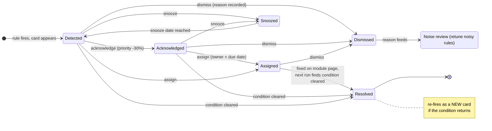
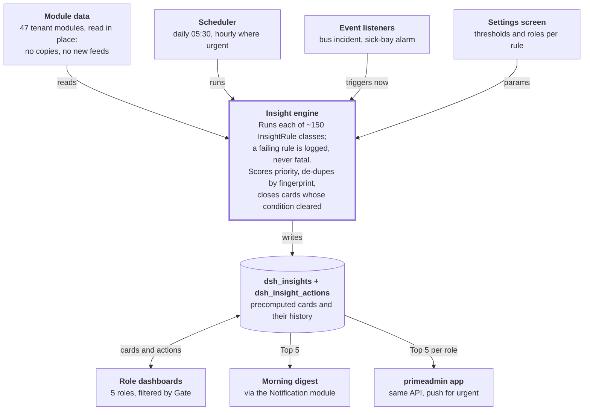

# Role Dashboard Insights — Plan

19 Oct 2026 · Tarun Chauhan · **Status: plan only, nothing built.**

## Contents

1. [Summary](#1-summary)
2. [Ten principles](#2-ten-principles)
3. [The insight card](#3-the-insight-card)
4. [Click to action: the insight lifecycle](#4-click-to-action-the-insight-lifecycle)
5. [Priority score](#5-priority-score)
6. [Role dashboards](#6-role-dashboards)
7. [Insight catalogue](#7-insight-catalogue)
8. [Architecture](#8-architecture)
9. [Data model](#9-data-model)
10. [How to write a rule](#10-how-to-write-a-rule)
11. [Prerequisites and data gaps](#11-prerequisites-and-data-gaps)
12. [Rollout](#12-rollout)
13. [Success metrics](#13-success-metrics)
14. [Decisions needed](#14-decisions-needed)

---

## 1. Summary

We will turn the 5 leadership dashboards (Super Admin, Principal, Vice Principal, Management, School Admin) from walls of KPIs into a **work queue**. Each morning a role sees the few things that need them today, why, and one click to the page where they act.

A scan of all 47 tenant modules (949 migrations, every report route, live row counts on test.localhost) found about **150 candidate insights**. Most can be built today, because the data and the detail pages already exist. Examples:

- A teacher's class average has dropped 10+ points since a given week (15 weeks of quiz data available).
- A bus's mileage fell after a driver change (`tpt_vehicle_fuel` records odometer, litres and driver).
- 51 of 76 library copies have never been issued; titles with a reservation queue need more copies.
- ₹2.76 Cr is overdue across 2,736 fee invoices, and some families who used to pay on time have started paying late.
- Teachers can be freed by the timetable optimisation plan.

**Scope:** tenant dashboards only. The central Prime super admin is out. Nothing is built yet: this plan needs the decisions in section 14 first.

---

## 2. Ten principles

A dashboard is world-class when a leader can act on it in under a minute without opening a spreadsheet. These ten rules decide every design choice below.

1. **Exceptions first, totals second.** The page leads with what is wrong or drifting. KPIs sit below as context. When nothing fires, the page says "All clear" and shows when it last checked.
2. **Every insight answers four questions:** what happened, how sure we are (the evidence), why it matters (students or rupees affected), and what to do next.
3. **One click lands on the exact rows.** The link carries the filters (teacher, class, date range), so the detail page opens already narrowed to the problem. It never lands on an unfiltered report.
4. **Compared with something.** Every number shows its baseline: the same entity's own history, a peer group (other sections, other vehicles), or a target. A number without a comparison is not an insight.
5. **Ranked, not listed.** A priority score orders the cards. Each role sees a "Top 5 today" strip, then the rest grouped by area with "+N more".
6. **Closed loop.** An insight can be acknowledged, assigned to an owner with a due date, snoozed or dismissed with a reason. The system notices when the condition clears and marks it resolved, so we can measure time-to-resolve.
7. **No noise.** Minimum sample sizes, hysteresis (an alert must clear by a margin before it can re-fire), and de-duplication. A rule whose cards are dismissed more than half the time gets retuned.
8. **Pushed, not only pulled.** Each role gets a short morning digest (in-app, email or WhatsApp) with the Top 5. Urgent items such as a bus incident or a sick-bay alarm are pushed when they happen.
9. **Scoped and private.** A card only shows if the viewer may open its target page (same Gate check). Medical data, salaries and student names follow existing privacy rules.
10. **Explainable and tunable.** A "Why am I seeing this?" line states the rule in plain words. Thresholds have defaults and can be overridden per school.

---

## 3. The insight card

Every insight on every dashboard uses the same card, so a leader learns to read it once.

Illustrative mock-up (LMS-01 on the Principal dashboard; the numbers are the example from the table, not live data):

```
┃ ┌──────────────────────────────────────────────────────────────────────────┐
┃ │ [ Alert · Academics ]                        Priority 82 · checked 06:00 │
┃ │                                                                          │
┃ │ Teacher A's 8-B Maths average fell 14 points                             │
┃ │ Since week of 1 Sep · 38 students affected                               │
┃ │                                                                          │
┃ │ ‾‾‾‾‾‾‾‾‾‾‾‾‾‾‾‾‾‾‾‾‾‾‾‾‾‾‾‾‾‾‾‾\           Baseline 71% (previous 8 weeks) │
┃ │                                 \___●      Now 57% (last 4 weeks)        │
┃ │                                                                          │
┃ │ Why am I seeing this? The last 4 weeks are 10+ points below the          │
┃ │ teacher's previous 8 weeks.                                              │
┃ │                                                                          │
┃ │ [ Open class performance ]  [Acknowledge] [Assign] [Snooze] [Dismiss]    │
┃ └──────────────────────────────────────────────────────────────────────────┘
(red bar on the left = Alert; amber = warning; blue = suggestion; grey = KPI)
```

| Field | What it shows | Example (LMS-01) |
| --- | --- | --- |
| Severity | Red alert, amber alert, suggestion or KPI, by icon and colour (never colour alone) | Red alert |
| Headline | One sentence with the entity and the number | Teacher A's 8-B Maths average fell 14 points |
| Since | When the condition started, from the rule's evidence | Since week of 1 Sep |
| Evidence | A sparkline of the measure, with the baseline band | 12 weekly averages, baseline 71%, now 57% |
| Impact | Who or what is affected, in the unit leaders care about | 38 students |
| Why | The rule in plain words (the "Why am I seeing this?" line) | Last 4 weeks are 10+ points below the teacher's previous 8 weeks |
| Primary action | One button that deep-links to the filtered detail page | Open class performance |
| Secondary actions | Acknowledge, Assign, Snooze, Dismiss (with reason) | Assign to VP, due Friday |
| Owner and due | Shown once assigned | VP, due 24 Oct |
| Freshness | When the rule last ran | Checked 06:00 |

**Primary action = a link, never a write.** As with the timetable suggestion card, the dashboard never changes school data itself. The user acts on the module's own page, where its validation and permissions apply. The only writes the dashboard makes are to the insight's own state (acknowledge, assign, snooze, dismiss).

---

## 4. Click to action: the insight lifecycle

An insight is a small task with a lifecycle, not a static number. A card only leaves the dashboard by being fixed, snoozed or dismissed, and every step is logged.



Resolution is detected, not claimed: the card closes when the next rule run no longer finds the condition. That gives a real time-to-resolve for each rule and each owner. The primary button is always a link to the module page; the dashboard never edits school data.

---

## 5. Priority score

Cards are ordered by one score from 0 to 100. The top 5 across all areas form the "Top 5 today" strip; the rest are grouped by area.

```
priority = 100 × S^0.4 × I^0.3 × U^0.2 × C^0.1
```

| Factor | Meaning | How it is set (0 to 1) |
| --- | --- | --- |
| S — severity | How bad if ignored | Fixed per rule: safety 1.0, money or compliance 0.8, quality 0.6, efficiency 0.4 |
| I — impact | How many students, how many rupees, how many staff | Log-scaled against the school's size, for example 38 of 1,758 students |
| U — urgency | How soon it bites | 1.0 if overdue or expiring within 7 days, falling to 0.2 at 60+ days |
| C — confidence | How solid the evidence is | Sample size and history length against the rule's minimum |

**Adjustments:** an acknowledged card drops by 30%, a snoozed card is hidden until its snooze date, and a card that has been open for more than 7 days without an owner rises by 10% a week. The weights are a starting point; tune them after the pilot using dismissal rates.

---

## 6. Role dashboards

All five dashboards share one layout; only the rules they are eligible for differ. IDs refer to the catalogue in section 7, and only the rules currently firing appear.

**Layout, top to bottom:**

1. **Greeting line:** "4 things need you today" plus data freshness ("checked 06:00").
2. **Top 5 today:** the highest-priority cards across all areas.
3. **My assigned items:** insights someone assigned to this user, with due dates.
4. **Alerts by area:** collapsible groups (Academics, Students, Staff, Finance, Operations, Compliance), at most 8 cards each, then "+N more".
5. **Suggestions:** savings and improvements, ranked by rupee or time value.
6. **KPI strip:** tiles, each with a trend arrow against last period and a link.
7. **Filter bar:** academic session (the house rule), plus area and "show snoozed".

| Role | Question the page answers | Alerts it is eligible for | Suggestions | KPI tiles |
| --- | --- | --- | --- | --- |
| Super Admin | Is the school system healthy, and what is broken? | Everything the other four see, plus SYS-01 backups, SYS-02 data quality, SYS-03 session setup, NTF-01 delivery failures, FEE-05 gateway failures, ACC-08 unposted totals | All | Active users by role, module adoption (needs data) |
| Principal | Is teaching good, are students safe, and are the key numbers on track? | LMS-01, 02, 03, 05, 11 · SYL-01 · MSH-01 · STU-01, 02, 03 · BA-01, 02 · HST-05 · TPT-06 · CMP-02 · HR-02, 03 · TT-03 · ADM-07 · CMP-01 · FEE-03 | TT-01 free teachers · TT-02 · LMS-04 · QB-01 | LMS-06, SYL-02, HR-01, STU-07, FEE-01, ADM-02, FBK-01 |
| Vice Principal | Who has to do what this week? | LMS-07, 08, 09, 10, 12, 13, 14, 15 · SYL-01, 03 · REC-01 · BA-03, 04 · HPC-01 · STU-01, 08 · HR-04 · PTM-01 | LMS-04 · QB-01 · TT-02 · PTM-02 | TT-06 substitutions, HR-01, SYL-02, REC-02, LMS-06 |
| Management | Where is money coming in, leaking out, or at risk? | FEE-02, 03, 04, 06, 09 · ACC-02, 03 · ADM-01, 07 · HR-08 · INV-06 · VND-01, 02 · TPT-01 · HST-07 | Savings: TT-01, TPT-07, TPT-08, TPT-10, LIB-01, INV-02, CAF-01, HST-02, VND-03, TT-04. Growth: ADM-04, LIB-02, CAF-02 | FEE-01, ACC-01, ACC-09, HR-07, ADM-02, HST-01, TPT-03, CAF-07, HR-10 |
| School Admin | What is expiring, pending or late? | Expiring: TPT-04, HR-06, STU-05, STU-04, CAF-05, VND-01, LIB-09, INV-04, INV-08. Pending: CRT-01, FEE-07, HR-05, HR-11, ACC-04, 05, 06, INV-01, 05, CAF-04, TPT-05, 09, 12, LIB-04, HST-03, 06, 09, 10, FOF-02, 04, CMP-01, ADM-03, 05, 06, NTF-01 | FEE-10 · PTM-02 · LIB-06 · INV-03 | FOF-01, HR-01, HST-01, TPT-03, FEE-01 |

**Management sees summaries, not named teachers,** in this draft (LMS-06 and SYL-02 rather than LMS-01 or LMS-07). That is an open decision.

**Morning digest per role:** Principal and VP at 07:00, Management at 09:00 on Mondays (weekly), School Admin at 08:00, Super Admin only on failures.

---

## 7. Insight catalogue

About 150 candidate insights across 14 module groups, each with a proposed default rule and the existing page it links to. Counts are live rows on test.localhost (`xyz_school_00000000000040008000_202627`) on 19 Oct 2026.

**Type:** Alert = something is wrong or drifting · Sugg = an action that saves money or time, or improves quality · KPI = a headline number with a trend · Note = an observation, not a dashboard item.
**Status:** R = tables exist and have data · R-thin = tables exist, few rows or short history, so trend rules need more weeks · ND = needs data we do not record today.


### LMS — Quiz, Quest, Homework, Exam

Data: 7,725 quiz/quest attempts over 15 weeks, 9,929 homework submissions over 12 weeks, 413 exam
results. Teacher link = `lms_quizzes.created_by` / `*_allocations.assigned_by` (same as the existing
teacher-monthly report); homework = `lms_homework.created_by`.

| ID | Insight | Type | Rule (proposed default) | Detail link | Status |
|---|---|---|---|---|---|
| LMS-01 | **Teacher's class average is falling** (from week X) | Alert | teacher × class-section × subject: last-4-week avg ≥10 pts below the teacher's own previous 8-week baseline, ≥3 assessments per window | lms-quize/quiz-reports?tab=class-performance | R |
| LMS-02 | Teacher consistently in the bottom 10% for the same subject+class | Alert | 6+ weeks | quiz-reports?tab=teacher-monthly | R |
| LMS-03 | Whole section falling in ≥3 subjects at once (class problem, not teacher) | Alert | same 4-week window | quiz-reports?tab=class-performance | R |
| LMS-04 | Same subject, sections ≥15 pts apart → pair the teachers / share material | Sugg | | quiz-reports?tab=class-performance | R |
| LMS-05 | Quiz high but term exam ≥20 pts lower (quizzes too easy / malpractice) | Alert | | lms-exam/exam-advanced-reports | R |
| LMS-06 | Exam result headline: pass %, avg %, grade split vs previous exam | KPI | | exam-advanced-reports | R |
| LMS-07 | **Homework grading backlog by teacher** | Alert | submitted, graded_at NULL > 7 days (3,864 of 9,929 today) | lms-home-work/home-work-report | R |
| LMS-08 | Exam answers not evaluated N days after exam end (70 today) | Alert | | exam-advanced-reports | R |
| LMS-09 | Teacher assigned no quiz/quest/homework for a class they teach in 3 weeks | Alert | vs timetable cells | quiz-reports?tab=teacher-monthly | R |
| LMS-10 | Exam grievances open >7 days (6 open); evaluators whose marks changed most | Alert | | exam-advanced-reports | R |
| LMS-11 | Exam ended, results not published after N days | Alert | | exam-advanced-reports | R |
| LMS-12 | Sections where >30% students skip allocated quizzes | Alert | allocation_detail vs attempts | quiz-reports | R |
| LMS-13 | Homework submission rate down ≥15 pts vs baseline | Alert | | home-work-report | R |
| LMS-14 | Students sliding ≥15 pts in ≥2 subjects (top 10) | Alert | | quiz-reports?tab=student-summary | R |
| LMS-15 | Online-test integrity flags (violation_count > 0) by class/exam | Alert | | exam-advanced-reports | R |

### Syllabus, QuestionBank, Recommendation, Marksheet, HPC

| ID | Insight | Type | Rule | Detail link | Status |
|---|---|---|---|---|---|
| SYL-01 | **Syllabus behind schedule** by class-section × subject × teacher | Alert | scheduled_end < today and not completed (54 of 844 due) | syllabus/report | R |
| SYL-02 | Syllabus completion % by class vs plan | KPI | | syllabus/report | R |
| SYL-03 | Disruptions not recovered past end date | Alert | | syllabus/report | R-thin |
| SYL-04 | Data quality: some topics are scheduled to end in 2042 — a sequencing bug to check, not a dashboard item | Note | | — | Bug |
| QB-01 | Bad questions → review/retire (discrimination < 0.1, difficulty outside 0.1–0.95, ≥30 attempts) | Sugg | qns_question_statistics | question-bank/question-report | R |
| QB-02 | School's own questions vs PrimeGurukul (37 vs 16,728) | KPI | | question-bank dashboard | R |
| REC-01 | Remediation ignored: pending/expired/skipped (662 of 1,681) by class | Alert | | recommendation/reports | R |
| REC-02 | Is remediation working? score after vs score that triggered it | KPI | | recommendation/dashboard | R |
| MSH-01 | Marksheet schedule past date but not computed/locked, or computation errors | Alert | | marksheet-generation/dashboard | R |
| HPC-01 | Students without an HPC report for the current term | Alert | | hpc dashboard | R-thin |

### Behaviour (BA) and student welfare (StudentProfile)

| ID | Insight | Type | Rule | Detail link | Status |
|---|---|---|---|---|---|
| BA-01 | Behaviour at-risk / declining students | Alert | is_at_risk or trend=declining (needs a 2nd scoring period) | behavioural-assessment/reports | R-thin |
| BA-02 | Open / high-severity / escalated incidents, follow-up date passed | Alert | 24 incidents | behavioural-assessment/reports/incidents | R |
| BA-03 | Interventions overdue | Alert | | reports/incidents | R |
| BA-04 | Teacher behaviour assessments still draft after the period deadline | Alert | | behavioural-assessment/dashboard | R |
| STU-01 | **Chronic absentees** (attendance < 75% in last 30 days) | Alert | std_student_attendance — only 209 rows today | student-profile/reports/chronic-absenteeism | R-thin |
| STU-02 | **Dropout radar** — absence + falling marks + fee overdue together | Alert | combines STU-01, LMS-14, FEE-02 | student-profile/reports/dropout-radar | R-thin |
| STU-03 | Medical follow-ups open, acute medical cases, allergy/chronic list for trips | Alert | std_medical_incidents (644) | student-profile/reports/medical-followup | R |
| STU-04 | Vaccinations due in next 30 days | Alert | std_vaccination_records (7,938) | student-profile/reports/medical-safety | R |
| STU-05 | Missing/unverified/expiring student documents | Alert | std_student_documents (5,258) | student-profile/reports/document-deficiency | R |
| STU-06 | Students without a valid emergency contact | Alert | | student-profile/reports/emergency-contact-alert | R |
| STU-07 | Strength by class/section vs capacity, gender/category mix | KPI | | student-profile/reports/student-strength | R |
| STU-08 | Student leave applications pending | Alert | | student-profile/reports/leave-review | R-thin |

### Admission, Certificate, PTM

| ID | Insight | Type | Rule | Detail link | Status |
|---|---|---|---|---|---|
| ADM-01 | **Seat-fill risk** — classes likely to stay under-filled at current conversion | Alert | | admission/reports/seat-fill-risk | R |
| ADM-02 | Funnel: enquiry → application → test → offer → admitted, vs last cycle | KPI | | admission/reports/conversion-funnel | R |
| ADM-03 | Enquiries with no follow-up in N days / counsellor SLA breach | Alert | adm_follow_ups | admission/reports/counselor-sla | R |
| ADM-04 | Lead source that converts best → spend more there | Sugg | lead_source × admitted | admission/analytics/funnel | R |
| ADM-05 | Offers expiring unpaid; admission fee pending | Alert | adm_allotments | admission/reports/fee-action | R |
| ADM-06 | Pipeline bottleneck stage (applications stuck > N days) | Alert | adm_application_stages | admission/reports/pipeline-bottlenecks | R |
| ADM-07 | **Withdrawals / TCs rising** — reasons, by class, vs last year | Alert | adm_withdrawals, adm_tc_requests | admission/reports | R |
| ADM-08 | Promotion: detained count by class | KPI | adm_promotion_batches | admission/reports | R |
| CRT-01 | Certificate requests pending past required-by date | Alert | crt_requests, fof_certificate_requests | certificate/reports | R |
| PTM-01 | PTM: booking %, parents not booked, attended % by teacher | KPI | ptm_slots / ptm_slot_bookings | ptm module | R-thin |
| PTM-02 | Classes where < 50% parents booked a PTM slot → reminder | Sugg | | ptm module | R-thin |

### Fees, Payment, Scholarship

Data: 7,011 invoices, 5,096 transactions, 2,971 gateway logs. **2,736 invoices overdue = ₹2.76 Cr balance today.**

| ID | Insight | Type | Rule | Detail link | Status |
|---|---|---|---|---|---|
| FEE-01 | Collection this month vs target / vs same month last year | KPI | | student-fee/dashboard | R |
| FEE-02 | **Overdue amount + ageing buckets** (0-30/31-60/61-90/90+) by class | Alert | fee_invoices | student-fee/dashboard/fee-collection-details | R |
| FEE-03 | **Families who used to pay on time and started paying late** | Alert | fee_defaulter_history avg_days_late trend | student-fee/dashboard | R |
| FEE-04 | Cheque bounces / pending clearance | Alert | fee_payment_reconciliation | student-fee/dashboard | R |
| FEE-05 | Gateway failure rate (failed ÷ attempted, last 7 days) | Alert | fee_payment_gateway_logs | student-fee/dashboard | R |
| FEE-06 | Fine waived total and by whom (leakage) | Alert | fee_fine_transactions.waived_by | student-fee/dashboard | R |
| FEE-07 | Concessions/refunds awaiting approval | Alert | fee_student_concessions, fee_refunds | student-fee/dashboard | R |
| FEE-08 | Scholarship fund remaining vs pending applications | KPI | fee_scholarships, *_applications | student-fee/dashboard | R |
| FEE-09 | Students with no fee assignment for the session (revenue missed) | Alert | std_student_academic_sessions minus fee_student_assignments | student-fee/dashboard | R |
| FEE-10 | Upcoming installment due next 7 days → send reminder | Sugg | fee_installments | student-fee/dashboard | R |

### Accounting

Mostly configuration so far (30 vouchers). Rules work; numbers will be small until real postings.

| ID | Insight | Type | Rule | Detail link | Status |
|---|---|---|---|---|---|
| ACC-01 | Cash + bank position today | KPI | ledger balances | accounting/report/cash-book, bank-book | R-thin |
| ACC-02 | **Budget vs actual** — cost centres over 90% / 100% of budget | Alert | acc_budget_lines vs voucher items | accounting/report/budget-variance | R-thin |
| ACC-03 | Payables overdue (vendor bills) / receivables ageing | Alert | acc_bill_reference_balances | accounting/report/outstanding-payables | R-thin |
| ACC-04 | Bank reconciliation not done for last month / unmatched entries | Alert | acc_bank_reconciliations | accounting/report/bank-reconciliation | R-thin |
| ACC-05 | Vouchers awaiting approval; self-approvals | Alert | acc_voucher_approvals | accounting/dashboard | R-thin |
| ACC-06 | Period not closed / blocking checklist items | Alert | acc_period_close_checklist | accounting/dashboard | R |
| ACC-07 | Exceptions raised by the 28 exception rules | Alert | acc_exceptions (0 rows today) | accounting/dashboard | R-thin |
| ACC-08 | Module totals not posted to accounts (fee/payroll/inventory vs ledger) | Alert | acc_module_reconciliation (0 rows) | accounting/dashboard | ND (no job fills it) |
| ACC-09 | Income vs expense by month, ratio analysis | KPI | | accounting/report/profit-and-loss | R-thin |
| ACC-10 | TDS due / not deposited | Alert | acc_tds_deductions vs acc_tds_payments | accounting | R-thin |

### HR, Staff attendance, Payroll

| ID | Insight | Type | Rule | Detail link | Status |
|---|---|---|---|---|---|
| HR-01 | Staff present today / late / absent / on leave | KPI | sch_employee_attendance | hr-staff/hr-reports | R |
| HR-02 | **Staff whose punctuality got worse** (late days this month vs their 3-month avg) | Alert | | hr-staff/hr-reports | R |
| HR-03 | Leave pattern: Mon/Fri or pre-holiday clusters; leave balance exhausted | Alert | sch_employee_leave_applications | hr-staff/hr-reports | R |
| HR-04 | Leave approvals pending / escalated | Alert | sch_employee_leave_approvals | hr-staff | R |
| HR-05 | Attendance corrections pending | Alert | | hr-staff | R |
| HR-06 | Employee documents expiring in 60 days; probation ending | Alert | sch_employee_documents, hrs_employment_details | school-setup/employee-reports | R |
| HR-07 | Payroll cost this month vs last, by department | KPI | pay_payroll_runs / _details | hr-staff/hr-reports | R |
| HR-08 | Payroll run not approved/locked by day N | Alert | | hr-staff | R |
| HR-09 | Appraisals pending; increment flags not processed | Alert | hrs_appraisals | hr-staff | R |
| HR-10 | Attrition: separations this year, by department | KPI | sch_employee_separations | hr-staff/hr-reports | R-thin |
| HR-11 | PF/ESI register not computed for last month | Alert | hrs_pf/esi_contribution_register | hr-staff | R |

### Timetable (Foundation, Smart, Standard) and substitution

Timetable cells are empty on test.localhost right now (DB reset). The rules exist in code.

| ID | Insight | Type | Rule | Detail link | Status |
|---|---|---|---|---|---|
| TT-01 | **Teachers we can free** — freeing plan A/B, periods saved | Sugg | existing optimisation report | timetable-foundation/optimisation-report | R |
| TT-02 | The 30 existing suggestions (load / rooms / class / cover / health) — top 3 | Sugg | TimetableSuggestionService | dashboard/timetable-management | R |
| TT-03 | Overloaded / under-loaded teachers vs min/max allocation | Alert | | smart-timetable/analytics/workload | R |
| TT-04 | Rooms underused (< 40%) → merge or repurpose | Sugg | | smart-timetable/analytics/utilization | R |
| TT-05 | Constraint violations in the published timetable | Alert | | smart-timetable/analytics/violations | R |
| TT-06 | Substitutions today; teachers taking the most substitutions | KPI | substitution history | substitute management | R |
| TT-07 | **Teacher change on a class+subject → did results change?** (the academic twin of your driver example) | Alert | compare published snapshots for a teacher swap, then LMS-01 before/after | quiz-reports | ND (needs a swap log or snapshot diff job) |

### Transport (Transport + SmartTransport)

Data: 26 vehicles, 56 personnel, 300 trips, 104 fuel entries (Oct 1–18 only), 4,441 boarding logs.

| ID | Insight | Type | Rule | Detail link | Status |
|---|---|---|---|---|---|
| TPT-01 | **Mileage dropped after a driver change** (your example) | Alert | km/l per vehicle from tpt_vehicle_fuel odometer + quantity (or tpt_trip start/end odometer ÷ fuel); split by driver_id; alert when the new driver's km/l is ≥15% below the vehicle's previous-driver baseline | transport/vehicle-fuel | R-thin (18 days of fuel so far) |
| TPT-02 | Vehicle with mileage falling regardless of driver → send for service | Sugg | 3-month trend | transport/vehicle-fuel | R-thin |
| TPT-03 | Fuel cost per km / per student by route, vs fleet avg | KPI | | transport/transport-report | R |
| TPT-04 | **Documents expiring**: fitness / insurance / pollution / fire-extinguisher (30 days), driver licences | Alert | tpt_vehicle, tpt_personnel (2 fitness, 1 insurance today) | transport/transport-dashboard | R |
| TPT-05 | Late trips: stops reached > 10 min after schedule, by route/driver | Alert | tpt_trip_stop_detail | transport/transport-report | R |
| TPT-06 | Trip incidents open; emergency flags | Alert | tpt_trip_incidents (51) | transport/transport-dashboard | R |
| TPT-07 | Route occupancy: seats used vs capacity → merge under-filled routes | Sugg | tpt_student_route_allocation_jnt vs vehicle capacity | transport/transport-report | R |
| TPT-08 | Students allocated but not boarding for 2 weeks → stop billing / check | Sugg | allocation vs boarding_log | transport/transport-report | R |
| TPT-09 | Failed daily inspections; service requests pending; maintenance due | Alert | tpt_daily_vehicle_inspection, tpt_vehicle_maintenance | transport/transport-dashboard | R |
| TPT-10 | Maintenance cost per vehicle (last 12 months) → replace instead of repair | Sugg | | transport/transport-report | R-thin |
| TPT-11 | Transport fee overdue | Alert | tpt_student_fee_detail | transport/transport-dashboard | R |
| TPT-12 | Driver attendance gaps | Alert | tpt_driver_attendance | transport/transport-dashboard | R |

### Library

Data is thin: 76 copies, 27 transactions → **51 of 76 copies never issued**.

| ID | Insight | Type | Rule | Detail link | Status |
|---|---|---|---|---|---|
| LIB-01 | **Dead stock — titles nobody issues** (no issue in 12 months, > 2 copies) → reduce copies / sell / donate | Sugg | lib_book_copies minus lib_transactions | library/reports/advanced-analytics | R-thin |
| LIB-02 | **Demand exceeds copies** — titles with a reservation queue or all copies out → buy more | Sugg | lib_physical_book_requests queue_position, copies out | library/reports/circulation | R-thin |
| LIB-03 | Popularity trend rising/falling (already computed) | KPI | lib_book_popularity_trends.trend_direction | library/library-mgt/analytics | R-thin |
| LIB-04 | Overdue books + outstanding fines | Alert | lib_transactions, lib_members.outstanding_fines | library/reports/fine-collection | R |
| LIB-05 | Lost / damaged copies this term | Alert | lib_book_copies | library/dashboard | R |
| LIB-06 | Classes/students who borrowed nothing this term → reading drive | Sugg | members × transactions | library/reports/circulation | R-thin |
| LIB-07 | Curriculum books with low usage (alignment score high, usage low) | Sugg | lib_curricular_alignment | library/reports/advanced-analytics | R-thin |
| LIB-08 | Stock audit overdue / missing copies found | Alert | lib_inventory_audit (0 rows) | library | ND (no audit run yet) |
| LIB-09 | Digital licences expiring | Alert | lib_digital_resources.license_end_date | library | R-thin |

### Inventory and Vendor

| ID | Insight | Type | Rule | Detail link | Status |
|---|---|---|---|---|---|
| INV-01 | Items at/below reorder level (2 today) | Alert | inv_stock_balances vs reorder_level | inventory/reports/reorder-alerts | R |
| INV-02 | **Slow / non-moving stock** → stop buying, use up | Sugg | | inventory/reports/fast-slow-movers | R |
| INV-03 | **Consumption spike by department** vs its 3-month average | Alert | inv_stock_issues by department_id | inventory/reports/consumption | R |
| INV-04 | Batches expiring in 30 days | Alert | inv_stock_entries.expiry_date | inventory/reports/expiry-alerts | R |
| INV-05 | POs pending delivery past expected date; GRNs with QC rejections | Alert | | inventory/reports/pending-po | R |
| INV-06 | **Price creep** — last purchase rate > rate contract / previous rate by 10% | Alert | inv_item_vendor_jnt vs inv_rate_contract_items_jnt | inventory/reports/purchase-register | R |
| INV-07 | Stock adjustment variance (physical vs system) | Alert | inv_stock_adjustment_items | inventory/reports/stock-balance | R-thin |
| INV-08 | Asset warranty expiring; asset maintenance due | Alert | inv_assets, inv_asset_maintenance | inventory/reports/asset-register | R-thin |
| VND-01 | Vendor agreements expiring in 60 days | Alert | vnd_agreements | vendor/dashboard/alerts | R |
| VND-02 | Vendor invoices unpaid past payment terms | Alert | vnd_invoices / vnd_payments | vendor/vendor-reports | R-thin |
| VND-03 | Usage below min-guarantee qty (paying for unused service) | Sugg | vnd_usage_logs vs min_guarantee_qty | vendor/vendor-reports | R-thin |

### Cafeteria

| ID | Insight | Type | Rule | Detail link | Status |
|---|---|---|---|---|---|
| CAF-01 | **Items nobody orders** → drop from menu | Sugg | caf_menu_items with 0 caf_order_items in 30 days | cafeteria/reports-page | R |
| CAF-02 | **Best sellers / demand rising** → prepare more, cut waste on the rest | Sugg | order_items trend | cafeteria/reports-page | R |
| CAF-03 | Wastage: consumption logged vs meals served | Alert | caf_consumption_logs vs caf_meal_attendance | cafeteria/reports-page | R |
| CAF-04 | Stock below reorder | Alert | caf_stock_items | cafeteria/dashboard | R |
| CAF-05 | FSSAI licence / audit expiring | Alert | caf_fssai_records | cafeteria/dashboard | R |
| CAF-06 | Meal-card balances low / negative | Alert | caf_meal_cards | cafeteria/dashboard | R |
| CAF-07 | Revenue by day; cancelled orders % | KPI | caf_orders | cafeteria/dashboard | R |
| CAF-08 | POS cash vs system mismatch | Alert | caf_pos_sessions (0 rows) | cafeteria | ND (POS not used) |

### Hostel

The richest operational data (54K mess attendance, 4,960 laundry, 4,149 movements, 3,352 visitors).

| ID | Insight | Type | Rule | Detail link | Status |
|---|---|---|---|---|---|
| HST-01 | Occupancy % and empty beds by hostel | KPI | hst_allotments vs beds | hostel/reports/occupancy | R |
| HST-02 | **Mess: meals planned vs consumed** → cut cooking quantity | Sugg | hst_mess_bills, hst_mess_attendance | hostel/reports/mess-suite | R |
| HST-03 | Students overdue from leave / gate pass not returned | Alert | hst_leave_passes.actual_return_date, hst_movement_log | hostel/reports/leave-passes | R |
| HST-04 | Out-of-hours visitor overrides | Alert | hst_visitor_log.is_outside_visiting_hours | hostel/reports/visitors | R |
| HST-05 | Sick-bay admissions this week; alarm vitals; hospital referrals | Alert | hst_sick_bay_* | hostel/reports/medical-suite | R |
| HST-06 | Hostel complaints past SLA; bed maintenance blocking beds | Alert | hst_complaints, hst_bed_maintenance_log | hostel/reports/maintenance-suite | R |
| HST-07 | Hostel fee demand unpaid | Alert | hst_fee_demands | hostel/fee-structures/defaulters | R |
| HST-08 | Incidents / warning letters by student (repeat offenders) | Alert | hst_incidents | hostel/reports/discipline-suite | R |
| HST-09 | Room-change requests pending (415 rows) | Alert | | hostel/reports | R |
| HST-10 | Laundry turnaround late / disputes | Alert | hst_laundry_tickets | hostel/reports/laundry-suite | R |

### Front Office, Complaint, Feedback, Notification, System

| ID | Insight | Type | Rule | Detail link | Status |
|---|---|---|---|---|---|
| FOF-01 | Visitors today; appointments today | KPI | fof_visitors, fof_appointments | dashboard/front-desk | R |
| FOF-02 | Keys not returned past expected time | Alert | fof_key_register | front-office/keys/overdue | R |
| FOF-03 | Early departures / gate passes this week (repeat students) | Alert | fof_early_departures, fof_gate_passes | dashboard/front-desk | R |
| FOF-04 | Phone-diary actions not completed | Alert | fof_phone_diary.action_required | dashboard/front-desk | R |
| CMP-01 | **Complaints past department SLA** | Alert | cmp_complaints vs cmp_department_sla | complaint/reports/summary-status | R |
| CMP-02 | High escalation / safety risk complaints (AI scores) | Alert | cmp_ai_insights.safety_risk_score | complaint/ai-insights | R |
| CMP-03 | Complaint category rising vs last month | Alert | | complaint dashboard | R-thin |
| FBK-01 | Feedback cycle results: lowest-scoring categories / teachers | KPI | fbk_answers by category | feedback/menu/analytics | R-thin |
| FBK-02 | Feedback cycle open, response rate below threshold | Alert | fbk_cycles | feedback | R-thin |
| NTF-01 | Notification delivery failures (SMS/WhatsApp/email) last 7 days | Alert | ntf_delivery_logs, tpt_notification_log | dashboard/all-notifications | R |
| SYS-01 | Last backup run failed / older than 24h | Alert | sys_backup_runs (Maintenance module) | system-config/dashboard | R |
| SYS-02 | Data-quality: students without class/section, teachers without capability, rooms without type | Alert | | school-setup/reports/class-subject-matrix | R |
| SYS-03 | Session/term setup incomplete for the coming session | Alert | sch_academic_term, sch_org_academic_sessions_jnt | dashboard/foundational-setup | R |


---

## 8. Architecture

Rules run on a schedule, not when a page opens. Dashboards read precomputed cards, so a page with 150 rules loads as fast as one with 5.



**Built on what exists:** the same pattern as `TimetableSuggestionService` (one method per rule, try/catch per rule, relative cached URLs), Laravel's scheduler for timing, the Notification module for digests, and the existing primeadmin API for mobile. A settings screen edits each rule's thresholds and the roles it shows for. Urgent rules (safety, transport) also listen to model events, so they fire within a minute instead of the next morning.

---

## 9. Data model

Four new tenant tables in the Dashboard module, prefix `dsh_` (proposed). Following the dev-stage rule, each is a new create migration with a seeder; no alter migrations. Because each school has its own tenant database, per-school thresholds live in the rules table itself.

| Table | One row per | Key columns |
| --- | --- | --- |
| `dsh_insight_rules` | Rule (LMS-01, TPT-01, ...) | rule_key (unique), module, title, type (alert, suggestion, kpi), severity_weight, default_params json, params json (school override), min_sample, schedule (realtime, hourly, daily), role short_names json, is_active |
| `dsh_insights` | Detected condition on one entity | rule_id, fingerprint (rule + entity hash; unique while open), entity_type + entity_id, academic_session_id, headline, payload json (evidence series, baseline, numbers), impact_count, impact_amount, confidence, priority_score, status, assignee_id, due_date, snoozed_until, first_detected_at, last_detected_at, resolved_at |
| `dsh_insight_actions` | Thing a person did to an insight | insight_id, action (viewed, opened_link, acknowledged, assigned, snoozed, dismissed, reopened, auto_resolved), actor_id, assignee_id, due_date, reason_code, note, created_at |
| `dsh_insight_runs` | Execution of a rule | rule_id, started_at, finished_at, duration_ms, status, rows_scanned, opened_count, resolved_count, error_message |

**Status values for `dsh_insights`:** open, acknowledged, assigned, snoozed, dismissed, resolved.

**Dismiss reasons (`reason_code`):** not a problem, already handled, wrong data, threshold too sensitive, other. These feed the noise review.

**Reuse, don't duplicate:** digest preferences use the existing `ntf_user_preferences`; digest delivery goes through the Notification module; permissions are Spatie (`tenant.dashboard.insights.viewAny`, `.act`, `.configure`).

---

## 10. How to write a rule

Each rule is one PHP class implementing an `InsightRule` interface, registered in a single registry. A rule only reads data and returns findings; the engine handles storage, priority, de-duplication and resolution.

```php
interface InsightRule
{
    public function key(): string;              // 'TPT-01'
    public function defaults(): array;          // ['drop_pct' => 15, 'min_fills' => 4]
    public function evaluate(InsightContext $ctx): iterable; // yields Finding objects
}

// A Finding carries: entityType, entityId, headline, evidence (series + baseline),
// impactCount, impactAmount, confidence (0-1), since (date), link (route name + filters).
```

**Spec template** (fill this in for each rule before coding it):

| Field | Example for TPT-01 |
| --- | --- |
| Key and title | TPT-01 Mileage dropped after a driver change |
| Roles | Management, School Admin |
| Question it answers | Is a new driver costing us fuel? |
| Entity | Vehicle |
| Measure | km per litre between consecutive fuel fills (odometer delta ÷ litres) |
| Baseline | Same vehicle, previous driver, last 60 days |
| Fires when | New driver's km/l is ≥15% below the baseline, with ≥4 fills on each side |
| Clears when | Gap back under 10% (hysteresis), or the driver changes again |
| Impact | Extra fuel cost per month in ₹ |
| Deep link | transport/vehicle-fuel?vehicle_id={id}&from={since} |
| Schedule | Daily 05:30 |
| Privacy | Driver name shown to Management and School Admin only |
| Test fixture | 1 vehicle, 8 fills, driver swap after fill 4, km/l 12 → 9.5 |

**Checklist for every rule:**

- [ ] Minimum sample guard, so no alert fires on 1 or 2 data points
- [ ] Wrapped in try/catch, so a failing rule logs to `dsh_insight_runs` and never breaks the page
- [ ] Scoped to the selected academic session
- [ ] Link uses `route(..., false)` (relative), because payloads are cached
- [ ] The detail page accepts the filters in the link (check it; add the query-string filter if missing)
- [ ] Gate check on the target page before the card shows
- [ ] Feature test with a fixture for both firing and clearing
- [ ] Demo seeder scenario, so the rule can be shown on /seeder

---

## 11. Prerequisites and data gaps

Most rules can be built on today's data. These gaps either limit a rule or block it, and each needs an owner.

| Gap | Affects | What is needed | Kind |
| --- | --- | --- | --- |
| Student attendance has only 209 rows | STU-01, STU-02 | Daily attendance actually marked, or a demo seeder | Data |
| Fuel log covers only 18 days | TPT-01, TPT-02 | 2+ months of fuel entries per vehicle | Data |
| Accounting has 30 vouchers | ACC-01 to ACC-10 | Real postings (fee, payroll and inventory events posting vouchers) | Data |
| Timetable cells empty after the DB reset | TT-01 to TT-06, LMS-09 | Regenerate and publish the timetable | Data |
| BA has one scoring period | BA-01 trend | A second period scored | Data |
| No record of a teacher taking over a class+subject | TT-07 | A teacher-swap log, or a job that diffs published timetable snapshots | Build |
| `acc_module_reconciliation` is never filled | ACC-08 | A nightly reconciliation job | Build |
| Cafeteria POS is not used | CAF-08 | POS sessions in use | Data |
| Library stock audit never run | LIB-08 | One audit run | Data |
| No module-usage query | Super Admin adoption KPI | Aggregate `sys_activity_logs` by module and role | Build |
| Detail pages may not accept filters in the URL | Every deep link | Check each linked page; add query-string filters where missing | Build |
| 6 role dashboards still show static demo data | All roles | Replace or wrap them (decision 8) | Build |
| Some syllabus topics are scheduled to end in 2042 | SYL-01, SYL-02 | Investigate the sequencing run before trusting syllabus alerts | Bug |

---

## 12. Rollout

One role at a time, Principal first, each phase gated on its pilot. As with the earlier dashboard rebuild, every phase starts with a written proposal that is approved before any code.

```mermaid
flowchart TB
    P0["<b>P0 Foundation</b><br/>Engine, 4 dsh_ tables, card component, settings screen<br/>Data gaps fixed: attendance, fuel history, timetable republished"]
    G0{{"Exit: fixture tests pass<br/>for firing and clearing"}}
    P1["<b>P1 Principal (pilot)</b><br/>About 30 rules: academics, safety, staff; Top 5 strip<br/>Replaces or wraps the current Principal dashboard (decision 8)"]
    G1{{"Exit: 2-week pilot,<br/>dismissals under 15% per rule"}}
    P2["<b>P2 Vice Principal</b><br/>About 25 rules: backlogs, syllabus, engagement, behaviour<br/>Assign flow live: the Principal assigns cards to the VP"]
    G2{{"Exit: 70% of cards acted<br/>on within 48 hours"}}
    P3["<b>P3 Management</b><br/>About 30 rules: fees, budget, admissions, savings suggestions<br/>Rupee impact on every card; weekly digest"]
    G3{{"Exit: Management signs off<br/>the rupee figures"}}
    P4["<b>P4 School Admin</b><br/>About 45 rules: expiring documents, pending queues, operations<br/>Daily 08:00 digest of what expires this week"]
    G4{{"Exit: expiry rules checked<br/>on a month of real data"}}
    P5["<b>P5 Super Admin, digests, mobile</b><br/>System-health rules, digests for all roles, primeadmin push<br/>Priority weights retuned from pilot dismissal data"]
    G5{{"Exit: all 5 roles live,<br/>no failing rules overnight"}}

    P0 --> G0 --> P1 --> G1 --> P2 --> G2 --> P3 --> G3 --> P4 --> G4 --> P5 --> G5
    style P1 stroke-width:3px
```



| Phase | Scope | Exit gate |
| --- | --- | --- |
| P0 Foundation | Engine, 4 `dsh_` tables, card component, settings screen; data gaps fixed | Fixture tests pass for firing and clearing |
| P1 Principal (pilot) | About 30 rules: academics, safety, staff; Top 5 strip | 2-week pilot, dismissals under 15% per rule |
| P2 Vice Principal | About 25 rules: backlogs, syllabus, engagement, behaviour; assign flow | 70% of cards acted on within 48 hours |
| P3 Management | About 30 rules: fees, budget, admissions, savings; rupee impact; weekly digest | Management signs off the rupee figures |
| P4 School Admin | About 45 rules: expiring documents, pending queues, operations; daily digest | Expiry rules checked on a month of real data |
| P5 Super Admin, digests, mobile | System-health rules, digests for all roles, primeadmin push; weights retuned | All 5 roles live, no failing rules overnight |

Dates are not set; they depend on the decisions below and on who on the team takes each phase. Rule counts are approximate, from the role mapping in section 6.

---

## 13. Success metrics

We measure whether leaders act, not whether the page loads. All of these come from `dsh_insight_actions` and `dsh_insights`.

| Metric | Target after the 4-week pilot |
| --- | --- |
| Leaders opening their dashboard on school days | 4 of 5 days |
| Cards with an action taken (acknowledged, assigned or link opened) within 48 hours | 70% |
| Median time from detection to resolved | Under 7 days |
| Dismissed as "not a problem" or "wrong data" | Under 15% per rule (above that, the rule is retuned) |
| Page load with cards painted | Under 1.5 seconds (cards are precomputed) |
| Rules failing in a nightly run | 0 |
| Recovered money tracked through suggestions (fees collected after FEE-03, fuel saved after TPT-01) | Reported monthly; no target in the pilot |

---

## 14. Decisions needed

None of these are settled. Each changes what gets built.

1. **Thresholds:** fixed defaults only, or a per-school settings screen with these as defaults?
2. **Management and named teachers:** should Management see teacher-level alerts (LMS-01, LMS-07), or summaries only?
3. **LMS-01 measure:** quiz and quest only, or a combined quiz, homework and exam score?
4. **Salary in TT-01:** the optimisation tab is salary-free by an earlier decision. Should the Management card show the rupee saving, or periods only?
5. **Needs-data items:** build the missing pieces (teacher-swap log, reconciliation job, usage query) in v1, or leave them out?
6. **Assign and snooze:** the timetable card was advice-only. Is writing the insight's own state (acknowledge, assign, snooze, dismiss) acceptable, given it never touches school data?
7. **Digests:** which channels in v1 (in-app only, or also email and WhatsApp), and at what times?
8. **Existing role dashboards:** replace their static widgets, or add the insight sections above what is there?
9. **Build order:** Principal first (suggested), then VP, Management, School Admin, Super Admin?
10. **Table prefix:** is `dsh_` acceptable for the four new tables?
