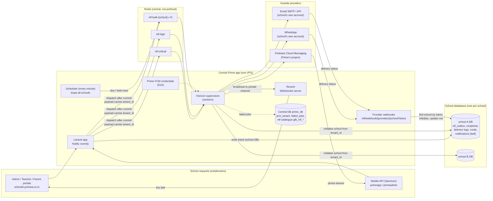
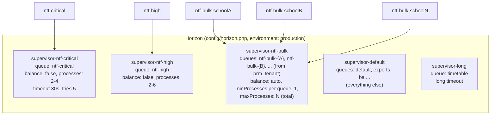
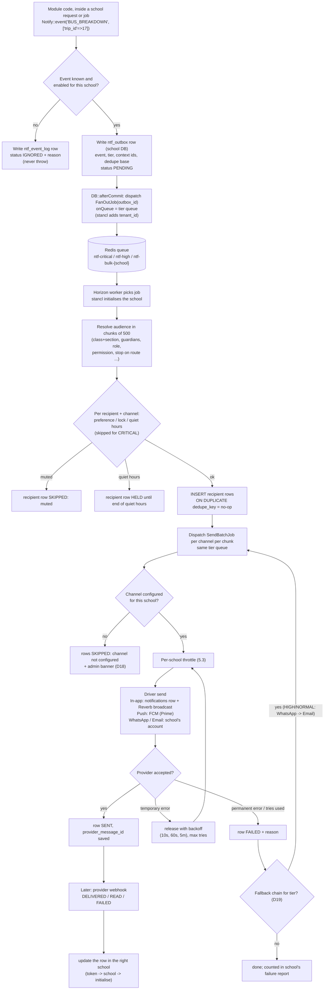
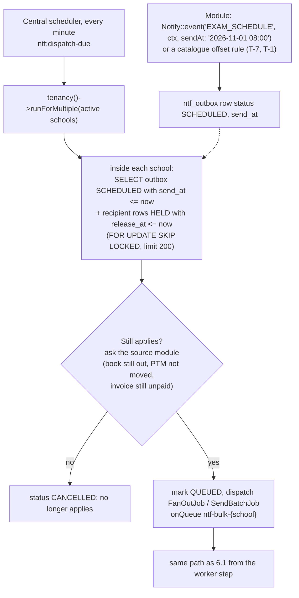
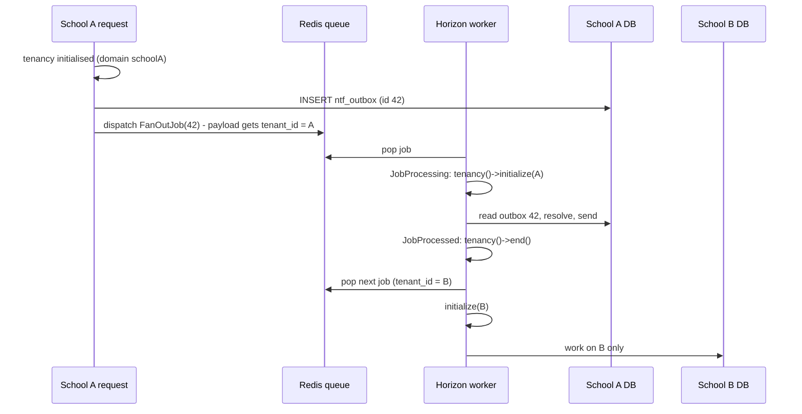

# Notification Delivery — Multi-School Queue Architecture & Build Plan

**Owner:** Tarun Chauhan · **Written:** 9 October 2026 · **Status:** PLAN ONLY, nothing built
**Builds on:** [NOTIFICATION-SYSTEM-PLAN.md](NOTIFICATION-SYSTEM-PLAN.md) (D1-D8), [NOTIFICATION-CATEGORIES.md](NOTIFICATION-CATEGORIES.md)
(400 requirements, 17 categories), [../NOTIFICATION-MODULE-GAP-REPORT.md](../NOTIFICATION-MODULE-GAP-REPORT.md) (what the code does today).
**Where this file wins:** where it disagrees with the 5 Oct plan, this file is newer. The disagreements are listed in §1.2.

---

## 0. The requirement, in one paragraph

One central Prime app serves many schools; each school has its own database. Every school sends **In-app (web
portals + Android app), WhatsApp and Email** (SMS is not a priority). Every send goes through a **queue**. Each event
has a **tier**: some must go **immediately** (bus breakdown, attendance), others may be **delayed or scheduled** (exam
schedule). The queue runs in the central app, but **every school must be isolated**: its jobs touch only its own
data, its bulk sends cannot slow down another school, it has its own queue, and its admin sees only its own sends.

---

## 1. Decisions

### 1.1 Taken 9 Oct 2026 (Q&A)

| # | Question | Decision |
|---|---|---|
| D9 | What must "isolated per school" protect? | **All four:** (a) right school's data, (b) fairness between schools, (c) a separate queue per school, (d) visibility per school. |
| D10 | Hosting | **VPS + Redis + Horizon.** (Confirms D3. Hostinger shared hosting cannot run this: no long-running workers, no Redis.) |
| D11 | Android "in-app" | **Real phone push + in-app list.** Needs `expo-notifications` and a new app release. |
| D12 | WhatsApp / Email accounts | **Each school brings its own** (confirms D1). |
| D13 | How the separate queues work | **Per-school queue for bulk / normal / scheduled sends (`ntf-bulk-{school}`); one shared top-priority queue set for urgent sends** that is always served first. |
| D14 | Push credentials | **Prime owns push only** (one Firebase project for primeapp). This **amends D1** for push; WhatsApp and Email stay per school. Closes plan Q1. |
| D15 | Tiers | **4 tiers:** `CRITICAL`, `HIGH`, `NORMAL`, `SCHEDULED` (§4). |
| D16 | Who sets the tier | **Prime catalogue fixes the tier.** A school may change channels, wording and send time for `NORMAL` / `SCHEDULED` events only. (Confirms D5.) |
| D17 | Web bell | **Live via Reverb.** Private channel per school + user. (Confirms D8.) |
| D18 | School has no WhatsApp / email credentials | **Send what works** (in-app + push), record the rest as `SKIPPED: channel not configured`, show a setup banner to the school admin. Never a silent skip. |
| D19 | A channel fails for a recipient | **Fallback chain per tier**, set in the Prime catalogue: `CRITICAL` already sends on every channel at once; `HIGH` / `NORMAL`: WhatsApp → Email (in-app + push always go); `SCHEDULED`: no fallback, mark failed. |

### 1.2 What changes in the 5 Oct plan

| 5 Oct plan said | Now |
|---|---|
| D1: all provider credentials per school | Per school for WhatsApp + Email; **push is Prime's** (D14) |
| D2: v1 channels incl. SMS | SMS **not a priority**: keep the driver slot, build it last (the OTP SMS path stays as is) |
| §6 queues `ntf-otp / ntf-high / ntf-fanout / ntf-bulk` (shared) | §5 below: shared urgent queues + **one bulk queue per school** |
| Q1 open (push vs D1) | Closed by D14 |

---

## 2. What stancl/tenancy already gives us (checked 9 Oct)

Package: `stancl/tenancy` **v3.10.1**. `QueueTenancyBootstrapper` is **enabled** (`config/tenancy.php:43`).
Source read: `vendor/stancl/tenancy/src/Bootstrappers/QueueTenancyBootstrapper.php`. Docs:
<https://tenancyforlaravel.com/docs/v3/queues>, <https://tenancyforlaravel.com/docs/v3/tenancy-bootstrappers>.

| Need | Handled by stancl? | How |
|---|---|---|
| Job remembers which school sent it | ✅ automatic | `createPayloadUsing()` adds `tenant_id` to every job payload **dispatched while tenancy is initialised** |
| Worker runs the job inside that school | ✅ automatic | on `JobProcessing` it calls `tenancy()->initialize(tenancy()->find($tenantId))`: school DB, filesystem, (cache when enabled) |
| Next job does not inherit the previous school | ✅ automatic | tenancy is **always ended between jobs** (`$forceRefresh` is deprecated because of this, since v3.8.5) |
| A job that must run centrally | ✅ by config | a queue connection with `'central' => true` gets **no** `tenant_id`, even when dispatched from a school page |
| Jobs stored in the central DB, not the school's | ⚠️ **our config** | docs: the `database` queue driver must have `'connection' => 'central'`. Ours reads `env('DB_QUEUE_CONNECTION')`, which is **unset** → it uses the default connection, which is the **school DB** inside a school request (each school DB has its own `jobs` table). Works today by luck. On Redis this problem disappears, but pin it anyway. |
| Redis queue not prefixed per school | ⚠️ **our config** | docs: if `RedisTenancyBootstrapper` is enabled, the queue's Redis connection must **not** be in `tenancy.redis.prefixed_connections`. It is disabled today; keep the queue on its own Redis connection either way. |
| Scheduler jobs (no school active) | ❌ not automatic | a scheduled command runs with no school. It must loop schools itself: `tenancy()->runForMultiple(null, fn () => …)`, then dispatch inside each school |
| Fairness between schools, per-school queues, per-school visibility | ❌ not provided | **we build these** (§5, §9) |
| Broadcasting (Reverb) per school | ❌ not provided | channel names must carry the school id (§8) |

**Summary:** stancl guarantees **D9(a) right school's data** once two config lines are fixed. **D9(b), (c), (d) are
ours to build.**

---

## 3. System overview



---

## 4. The four tiers (D15)

The tier is a column on the Prime catalogue event (`glb_ntf_events.tier`) and is **copied to each school's event and
to each outbox row**, so a worker never has to look it up again.

| Tier | Examples (from the 400) | Target | Queue | Channels | Quiet hours / user mute | Fallback (D19) | Dedupe key |
|---|---|---|---|---|---|---|---|
| `CRITICAL` | bus breakdown, accident, school closure, missing child, OTP, POCSO | **< 30 s** to provider | `ntf-critical` (shared) | **all enabled channels in parallel** | **ignored**, cannot be muted | none needed: already every channel | `{event}:{incident}:{recipient}` |
| `HIGH` | attendance absent / late, bus reached stop, leave approval request, payment receipt | **< 2 min** | `ntf-high` (shared) | per event, e.g. Push + In-app + WhatsApp | quiet hours respected **except** attendance-type events (catalogue flag) | WhatsApp → Email | `{event}:{record}:{recipient}` |
| `NORMAL` | results published, homework allocated, announcements, circulars | **< 15 min** | `ntf-bulk-{school}` | per event | respected (held, released after) | WhatsApp → Email | `{event}:{record}:{recipient}` |
| `SCHEDULED` | exam schedule, fee due T-7, PTM in 24 h, library due, digests | **at `send_at`** (±1 min) | `ntf-bulk-{school}` when due | per event | respected | none, mark failed | `{event}:{record}:{offset}:{recipient}` |

Rules:
- A school **cannot change** an event's tier (D16). It may change channels, wording, and (for `NORMAL` /
  `SCHEDULED`) the send time.
- `CRITICAL` events are **locked on**: no user preference, no quiet hours, no school-level disable.
- In-app is **always** written for every tier (it is the record the parent can scroll back to).

---

## 5. Queue topology and isolation (D9, D13)

### 5.1 Queues

| Queue | Shared? | Holds | Why |
|---|---|---|---|
| `ntf-critical` | shared by all schools | fan-out + send jobs of `CRITICAL` events | always served first, dedicated workers that never run anything else |
| `ntf-high` | shared | fan-out + send jobs of `HIGH` events | small payloads (one family / one person), fast |
| `ntf-bulk-{tenant_id}` | **one per school** | fan-out + send jobs of `NORMAL` and due `SCHEDULED` events | school A's 3,000-parent broadcast sits in **its own** queue and cannot delay school B |
| `default`, `timetable`, … | existing | all non-notification jobs (timetable generation, exports, BA, payroll) | **separate supervisors**, so a long timetable run never takes a notification worker (plan Q7) |

`CRITICAL` and `HIGH` stay shared because they are small and rare. A per-school copy would only add worker
processes; fairness among them comes from the per-school throttle (§5.3).

### 5.2 Horizon supervisors



**How the per-school queue list gets into Horizon.** Horizon reads its supervisor config when it starts. So:
1. `HorizonServiceProvider` builds the `supervisor-ntf-bulk.queue` list from central `prm_tenant` (active schools),
   cached in a file on deploy.
2. When a school is **created, activated or deactivated**, the tenant pipeline runs
   `php artisan ntf:horizon-queues --refresh && php artisan horizon:terminate`. Supervisor (the Linux process manager)
   restarts Horizon, which then picks up the new list. In-flight jobs finish first; nothing is lost.
3. Until its queue is listed, a new school's bulk jobs **wait in Redis**. They are not lost, only delayed until the restart.

⚠️ **Sizing risk to measure in Phase 0.** With `balance: auto`, Horizon keeps at least `minProcesses` (1) worker **per
queue**. 50 schools means at least 50 bulk worker processes (each about 60-80 MB of PHP), plus critical, high and
default. Phase 0 measures the RAM on the VPS. If it is too much, the fallback keeps the same fairness on fewer
processes: **one shared `ntf-bulk` queue + the per-school throttle in §5.3**. That switch is a config change, not a
redesign, because jobs already carry their school and the throttle key.

### 5.3 Per-school throttle (fairness inside the shared queues, and provider limits)

Every send job wraps its provider call in a Redis throttle keyed by **school + channel**:

```
Redis::throttle("ntf:{tenant_id}:{channel}")->allow($limitPerSecond)->every(1)
    ->then(fn () => $driver->send(...), fn () => $this->release(2));
```

- `$limitPerSecond` comes from the school's provider row (WhatsApp and SMTP accounts have their own rate limits).
- A school that floods `ntf-high` is slowed down **on its own key**; other schools' keys are untouched.
- `CRITICAL` jobs use a separate, higher limit key (`ntf:{tenant}:{channel}:crit`), so a bulk send never throttles an emergency.

### 5.4 The four isolations, and what delivers each

| D9 | Isolation | Mechanism | Test that proves it (Phase 0 / 9) |
|---|---|---|---|
| (a) | Right school's data | stancl `tenant_id` in payload + worker initialise/end per job; jobs carry **ids only**; queue connections pinned to central; Reverb channel names carry the school id; webhooks resolve the school by a per-school token | dispatch from school A, assert the job reads A's DB; run A then B jobs on one worker, assert B never sees A's rows |
| (b) | Fairness | per-school bulk queues + Horizon `auto` balance; per-school throttle; urgent tiers on dedicated supervisors | school A queues 3,000; school B's `HIGH` event still arrives < 2 min; B's `NORMAL` < 15 min |
| (c) | Separate queue per school | `ntf-bulk-{tenant_id}` | Horizon dashboard shows one queue per school |
| (d) | Visibility per school | **school screens read the school's own `ntf_*` rows**, never Horizon or Redis. Horizon is cross-school, so it is **Prime super-admin only** (`Horizon::auth` gate on central admin) | a school admin's delivery screen shows only its rows; the `/horizon` URL is 403 from a school domain |

---

## 6. Life of one notification

### 6.1 Immediate path (CRITICAL / HIGH / NORMAL)



### 6.2 Scheduled and held path (SCHEDULED, quiet hours)



Rules:
- The sweep **never sends**. It only dispatches, inside the school (so stancl tags the job).
- A school's sweep is capped (200 rows a minute) so one school cannot make the sweep slow for the others. The rest go next minute.
- When the source date changes (a PTM is moved), the module calls `Notify::reschedule(...)` or `Notify::cancel(...)`
  with the same dedupe base. The old offset rows become `CANCELLED`.

### 6.3 How the school travels with the job (stancl, verified in source)



---

## 7. Channels

| Channel | Credentials (D12, D14) | Where they live | Driver notes |
|---|---|---|---|
| **In-app (web)** | none | — | Laravel `notifications` table in the school DB (**the one in-app store**; `/inbox` on `ntf_delivery_logs` becomes the admin delivery audit only, gap report §4.4) + Reverb broadcast (§8) |
| **In-app (Android list)** | none | — | existing `/api/notifications` (`MobileNotificationController`) reads the same `notifications` table |
| **Push (Android)** | **Prime's** Firebase project | central config / env, never in a school DB | FCM HTTP v1. App: add `expo-notifications`, register the device token after login via a new `POST /api/devices`, delete on logout. **One** token table: school `ntf_user_devices` (the ParentPortal session token columns and Transport `pg_fcm_token` are migrated or ignored, gap report §4.6). `CRITICAL` uses high priority + a sound channel; `HIGH` live events (bus stop) use a **collapse key** and **TTL** |
| **WhatsApp** | **school's own** account | school `ntf_provider_master` (encrypted) | template messages only (Meta rule for business-initiated messages); each template must be approved in the school's WhatsApp account, so the catalogue carries a template name + variable order per language. Provider choice still open (§12) |
| **Email** | **school's own** SMTP / API key | school `ntf_provider_master` (encrypted) | mailer built per send from the school's row (never the global `.env` mailer); attachments (receipt PDF) rendered **in the worker** |
| SMS | school's own | school `ntf_provider_master` | not a priority (D2 amended); reuse `SmsDispatchJob`'s MSG91 / Twilio code when built. The OTP path stays as is |

---

## 8. Live bell (Reverb, D17)

- Private channel name: **`school.{tenant_id}.user.{user_id}`**. The school id is in the name, so two schools'
  user 5 never share a channel.
- Channel authorisation route runs **inside the school** (school domain, tenancy middleware) and allows only
  `auth()->id() === user_id` **and** `tenant('id') === tenant_id`.
- The in-app driver writes the `notifications` row, then broadcasts `NotificationCreated` (unread count + title).
  It runs in the worker, where stancl has already initialised the school.
- Reverb runs as one central process on the VPS (it is already installed for CommonChat). Config:
  `BROADCAST_CONNECTION=reverb` + `config/reverb.php` + `config/broadcasting.php`, none of which exist yet.
- Android does not use Reverb; it gets push (§7).

---

## 9. Per-school visibility (D9 d)

Everything a school admin sees comes from **its own DB**:

| Screen (school) | Reads |
|---|---|
| Sent notifications | `ntf_outbox` (one row per event fired) with counts: resolved / sent / delivered / read / failed / skipped |
| Recipients of one send | recipient rows with status + reason (muted, quiet hours, no contact, channel not configured, provider error) |
| Failures + retry | FAILED rows; **Retry** re-dispatches only those rows (dedupe keeps it safe) |
| Pause / cancel a broadcast | sets outbox `PAUSED` / `CANCELLED`; workers check the flag before each chunk |
| Channel setup | `ntf_provider_master` (existing tab) + a **Test send** button + "not configured" banner (D18) |
| Scheduled | outbox `SCHEDULED` rows with Edit time / Cancel |

Prime super admin (central) gets **Horizon** (all queues, all schools, throughput, failed jobs) plus a central
"schools with failing channels" report built from a nightly per-school count. A school can never open Horizon.

---

## 10. Configuration changes (exact)

| File / place | Change |
|---|---|
| VPS | install Redis 7 + **phpredis** extension (stancl's Redis bootstrapper needs phpredis); Supervisor programs for `horizon`, `reverb:start`, `schedule:work` |
| `.env` | `QUEUE_CONNECTION=redis`, `REDIS_QUEUE_CONNECTION=queue`, `CACHE_STORE=redis`, `BROADCAST_CONNECTION=reverb`, `REVERB_*` |
| `config/database.php` → `redis` | add a `queue` connection (own DB index, **no prefix**) separate from `default` / `cache` |
| `config/queue.php` | `database.connection` → `'central'` (docs requirement, even if unused); `redis.connection` → `'queue'`; add a `central` connection with `'central' => true` for central-only jobs; `after_commit` → `true` for the redis connection |
| `config/tenancy.php` | keep `QueueTenancyBootstrapper`; enable `CacheTenancyBootstrapper` once cache is Redis (tags); if `RedisTenancyBootstrapper` is enabled later, **do not** list the `queue` connection in `prefixed_connections` |
| `config/horizon.php` | supervisors of §5.2; `HorizonServiceProvider` fills the bulk queue list and restricts `viewHorizon` to Prime super admins on the central domain |
| `routes/console.php` | `ntf:dispatch-due` every minute (loops schools); existing `notifications:process-due` removed (it is replaced) |
| Tenant pipeline (create / activate / deactivate school) | run `ntf:horizon-queues --refresh` + `horizon:terminate` |

---

## 11. Build phases

Each phase has its own go. Nothing starts without it.

| Phase | What | Acceptance (all must be true) |
|---|---|---|
| **0. Infrastructure + isolation proof** | Redis + phpredis + Horizon + Reverb on the VPS and locally; §10 config; supervisors of §5.2; scheduler loop helper; **fix-now F1-F5** from the gap report | a job dispatched from school A runs in A; A-then-B on one worker never mixes; `/horizon` is 403 from a school domain; **RAM measured for 1 bulk worker per school** at the expected school count → decide per-school queues vs fallback (§5.2) |
| **1. Catalogue + tiers + entry point** | `glb_ntf_events` (code, tier, category, default channels, fallback chain, dedupe shape, variables), school copy synced at school creation, `Notify::event / reschedule / cancel`; `ntf_outbox` + recipient tables (nullable user id + contact columns for people with no login) | an unknown or disabled code is recorded, never thrown; the call returns in milliseconds; a school cannot change a tier |
| **2. Audience + fan-out** | audience types (user, role, permission, class+section, guardians of students, staff, reporting manager, transport stop, option subgroup); chunked; dedupe; preferences + locks + quiet hours | 3,000 guardians resolve < 60 s without loading them all; same event twice = no duplicate rows; class and section always match together |
| **3. In-app + live bell** | in-app driver on the new pipeline, one in-app store, Reverb private channels, school delivery screens (§9, first version) | a teacher's open browser updates without refresh; a school A user cannot subscribe to a school B channel; the mobile list shows the same rows |
| **4. Email (per-school)** | per-school mailer from `ntf_provider_master`, test send, attachments in worker, D18 "not configured" state | a forced SMTP failure retries then marks FAILED with reason; a school without SMTP gets SKIPPED rows + banner |
| **5. WhatsApp (per-school)** | driver for the chosen provider, template mapping per language, webhook with per-school token, fallback WhatsApp → Email | a number not on WhatsApp falls back to email; a webhook with a wrong token is rejected and logged |
| **6. Push (Prime FCM) + app release** | FCM v1 driver, `expo-notifications` in primeapp, device-token API, collapse key + TTL | a parent's phone shows a `CRITICAL` banner with the app closed; logout removes the token |
| **7. Scheduled + held + digest** | `ntf:dispatch-due`, offsets (T-7, T-1, T-1h), "still applies?" check, reschedule / cancel, quiet-hours release | a moved PTM never fires its old reminder; a quiet-hours WhatsApp is sent at the end of quiet hours |
| **8. Migrate callers** | HrStaff leave, Transport trip, Hostel stub, Library, Complaint, HPC, FrontOffice, Fee; **BehaviouralAssessment last** (it rides `trigger()` today, so keep `trigger()` as a wrapper until BA moves) | no module sends with `Mail::` / `notify()` / its own "Sent" log any more |
| **9. Load test + runbook** | 3,000-recipient broadcast on 2 schools at once while a third fires `CRITICAL` | `CRITICAL` < 30 s, `HIGH` < 2 min during the load; runbook "notifications stuck" written |

---

## 12. Still open (ask before the phase that needs it)

| # | Question | Needed by |
|---|---|---|
| O1 | How many schools in year 1 and year 2? (sizes the per-school bulk workers, §5.2) | Phase 0 |
| O2 | WhatsApp: Meta Cloud API directly, or a BSP (Gupshup / Interakt / AiSensy / MSG91 WhatsApp)? Schools bring their own account, so one driver per provider we support. | Phase 5 |
| O3 | Push transport: **FCM v1 directly** (native device token from `getDevicePushTokenAsync`) or **Expo Push Service** (Expo token, simpler, one more third party)? | Phase 6 |
| O4 | Default quiet hours (e.g. 21:00-07:00), and may a school change them? | Phase 2 |
| O5 | Template languages at launch (English + Hindi, or regional)? WhatsApp templates are approved per language per school account. | Phase 1 |
| O6 | Approval before a broadcast over N recipients (plan Q6)? | Phase 2 |
| O7 | Retention of outbox / recipient / delivery rows (plan Q4, DPDP)? | Phase 7 |
| O8 | Does primeadmin (staff app) also get push, or only primeapp (parents / students)? | Phase 6 |

---

## 13. Rules for every session that builds this

1. **Jobs carry ids only** (`FanOutJob($outboxId)`), never models, user lists, credentials or rendered text.
2. **Dispatch after commit**, always.
3. **No send inside a web request.** The request writes the intent; workers send.
4. **Scheduled commands loop the schools** and dispatch inside each one. Never dispatch a school job with no school active.
5. **Every queue name for a school's bulk work is `ntf-bulk-{tenant_id}`**, and only the per-school list in Horizon knows them.
6. **School screens read school tables only.** Horizon and Redis are Prime-only.
7. **Every not-sent outcome is a row with a reason**: muted, held, no contact, not configured, failed, cancelled.
8. **Credentials:** WhatsApp / Email in the school DB, encrypted, never logged; FCM key central only.
9. **Webhooks prove their school** with the per-school token before touching anything.
10. **Reverb channel names always carry the school id.**
