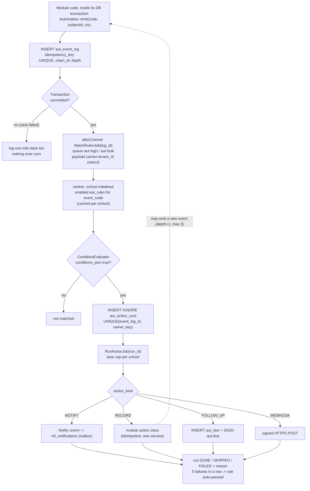
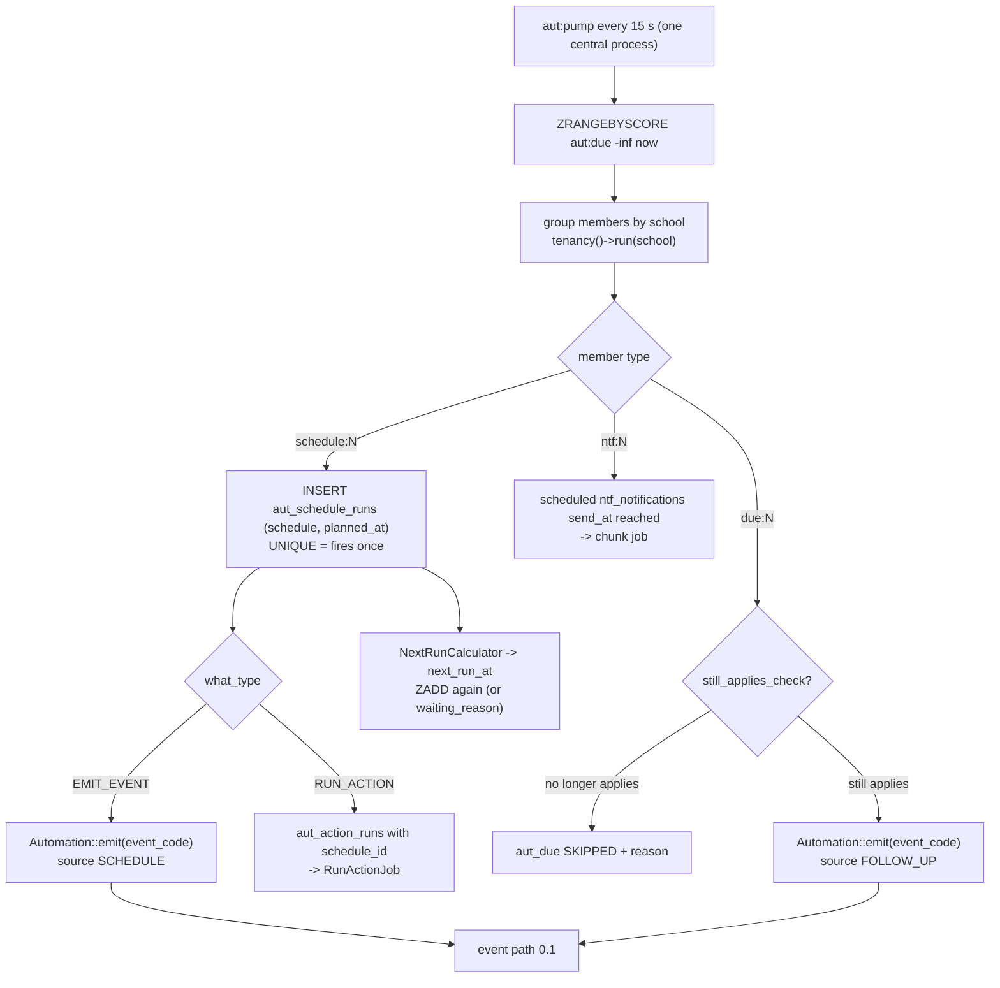
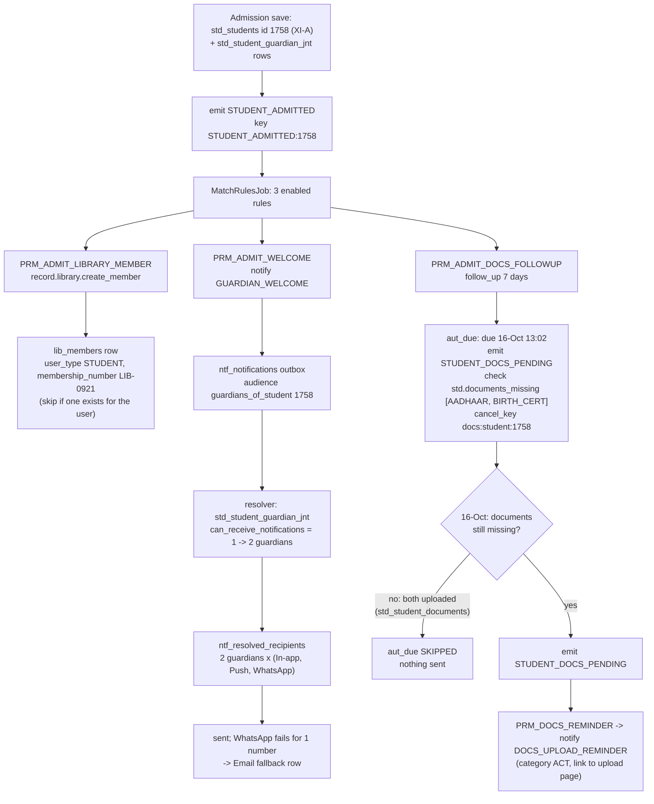
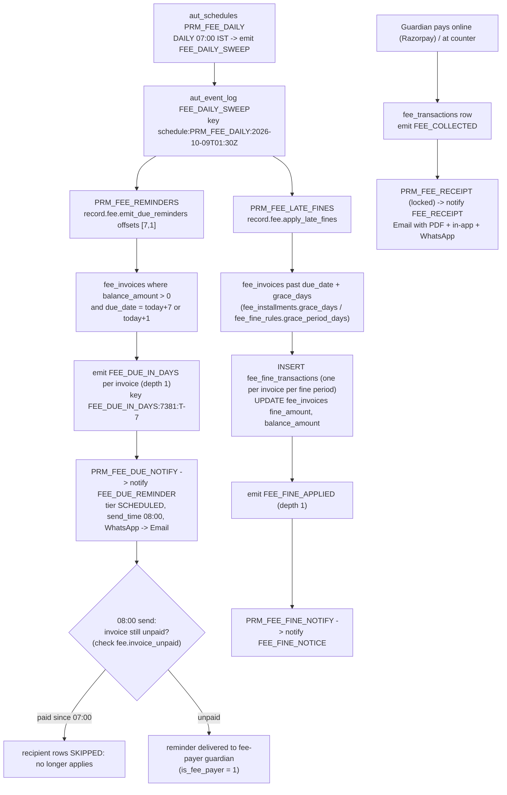
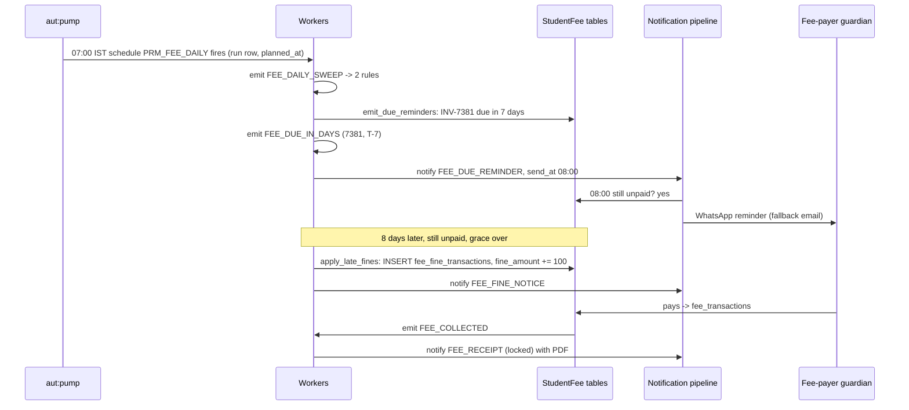
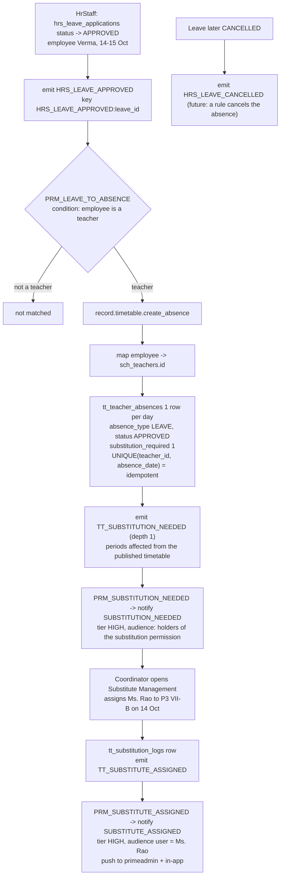
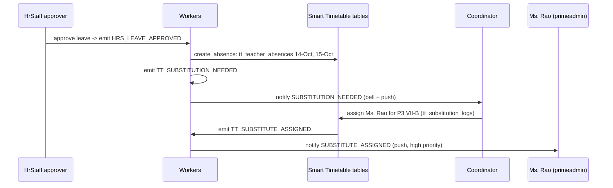
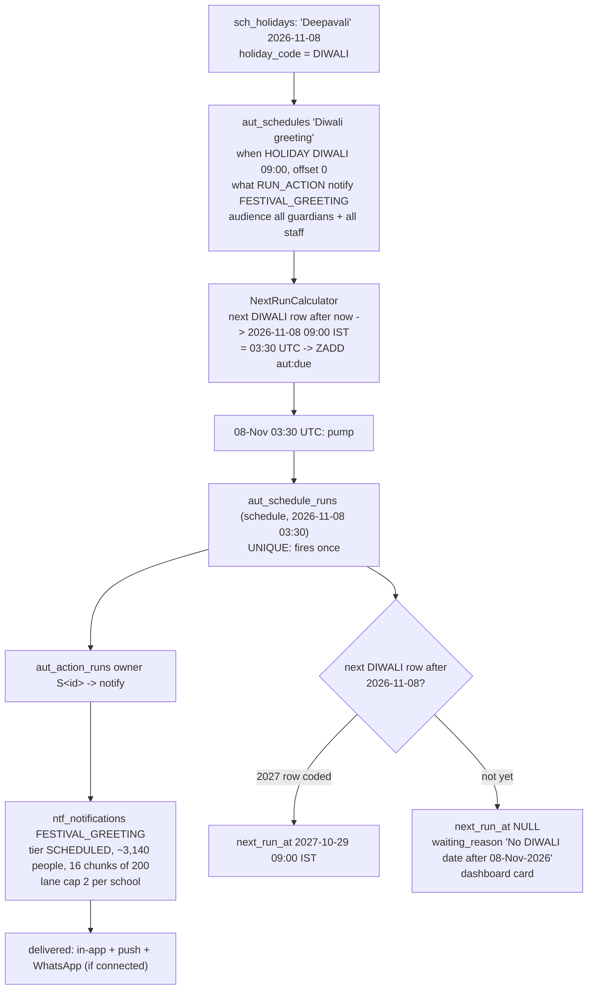
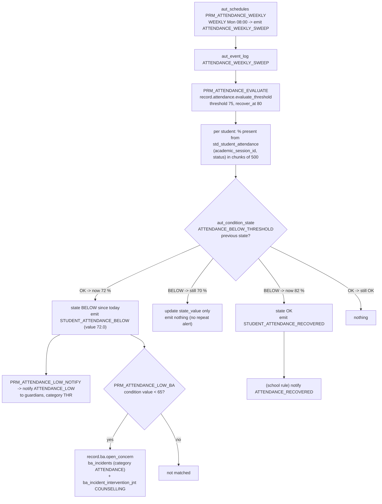

# Automation Core — Flowcharts with Live Examples from Prime-AI

**Written:** 9 October 2026 · **Status:** DESIGN, nothing built
**Read with:** [01-IMPLEMENTATION-PLAN.md](01-IMPLEMENTATION-PLAN.md) (classes, phases) · [02-SCREEN-DESIGN.md](02-SCREEN-DESIGN.md) (screens)
**Tables:** real table names from the test school DB (checked 9 Oct 2026). `aut_*` / `ntf_*` v4 columns come from the new DDL.

Every example has: **(a)** a flowchart, **(b)** a sequence diagram where timing matters, and **(c)** a step table that
says what happens and **which row to look at** when you test by hand.

| # | Example | Starts from | Ends in |
|---|---|---|---|
| 1 | Student admitted | a record change (module event) | a record action **+** a notification **+** a follow-up that may never fire |
| 2 | Fee reminders + late fee | a daily schedule (sweep) | many notifications **+** a money record action **+** a receipt |
| 3 | Teacher leave approved | a record change in HR | a record action in another module (Timetable) → notifications to two different people |
| 4a | Diwali greeting | a holiday schedule | a notification only |
| 4b | Attendance below 75 % | a weekly schedule (sweep) | a notification **+** a record action, **once per crossing** |

---

## 0. The two engine paths every example uses

### 0.1 Event path (something happened)



### 0.2 Time path (a schedule or follow-up came due)



---

## 1. Example 1 — Student admitted

**Story:** The office admits *Aarav Sharma* into XI-A (a hosteller). Three Prime rules react:
1. create his **library membership**;
2. send a **welcome message** to his guardians;
3. **in 7 days**, remind the guardians to upload Aadhaar and birth certificate, **only if they are still missing**.

### 1(a) Flowchart



### 1(b) Sequence

```mermaid
sequenceDiagram
    participant UI as Office (admission form)
    participant DB as School DB
    participant Q as Redis queues
    participant W as Workers
    participant G as Guardians' phones

    UI->>DB: BEGIN; INSERT std_students 1758; INSERT aut_event_log (STUDENT_ADMITTED:1758); COMMIT
    DB-->>Q: afterCommit MatchRulesJob(log)
    Q->>W: MatchRulesJob (school initialised)
    W->>DB: 3 rules match -> 3 aut_action_runs
    W->>DB: run 1: INSERT lib_members (LIB-0921)
    W->>DB: run 2: INSERT ntf_notifications + 6 recipient rows
    W->>G: in-app (Reverb), push (FCM), WhatsApp (school number)
    W->>DB: run 3: INSERT aut_due (16-Oct)
    Note over W,DB: 7 days later
    W->>DB: pump: still_applies std.documents_missing?
    alt documents uploaded
        W->>DB: aut_due SKIPPED
    else still missing
        W->>DB: emit STUDENT_DOCS_PENDING -> notify DOCS_UPLOAD_REMINDER
        W->>G: reminder with upload link
    end
```

### 1(c) Steps to check

| # | What happens | Look at |
|---|---|---|
| 1 | Student saved and event logged in **one** transaction | `std_students` 1758 + `aut_event_log` (event `STUDENT_ADMITTED`, `idempotency_key STUDENT_ADMITTED:1758`, `status MATCHED`, `matched_rules 3`) |
| 2 | Three runs, one per rule | `aut_action_runs` × 3, same `event_log_id`, owner `R<rule_id>` |
| 3 | Library membership created | `lib_members` (`user_id` = student's user, `user_type STUDENT`); run `result_json {"lib_member_id":…}` |
| 4 | Welcome send created | `ntf_notifications` (`event_code GUARDIAN_WELCOME`, `origin RULE`, `aut_action_run_id`, `dedupe_base GUARDIAN_WELCOME:1758`) |
| 5 | Only guardians allowed to receive | `std_student_guardian_jnt.can_receive_notifications = 1` → `ntf_resolved_recipients` rows (`contact_type GUARDIAN`, `contact_ref_table std_guardians`) |
| 6 | WhatsApp fails for one number → email | recipient `state FAILED reason "not on WhatsApp"` + new row `channel EMAIL`, `fallback_of_id` = failed row |
| 7 | Follow-up waiting | `aut_due` (`status WAITING`, `due_at` +7 days, `cancel_key docs:student:1758`), AUT-09 |
| 8a | Documents uploaded before day 7 | `std_student_documents` has both types → `aut_due status SKIPPED reason "no longer applies"` |
| 8b | Still missing on day 7 | new `aut_event_log` `STUDENT_DOCS_PENDING` (`source FOLLOW_UP`, same `chain_id`) → notify `DOCS_UPLOAD_REMINDER` |
| 9 | Admission saved twice / retried | still one `aut_event_log`, one `lib_members`, one send (`uq_ntf_dedupe_base`) |

---

## 2. Example 2 — Fee due reminders + late fee + receipt

**Story:** Every morning at 07:00 the school's **Fee daily sweep** runs. It finds invoices due in 7 days and in
1 day and sends reminders. It finds overdue invoices past their grace period and applies the late fine from
`fee_fine_rules`. When a guardian pays, a receipt goes out. The receipt rule is 🔒 locked.

### 2(a) Flowchart



### 2(b) Sequence (one invoice, INV-7381)



### 2(c) Steps to check

| # | What happens | Look at |
|---|---|---|
| 1 | 07:00 firing recorded once | `aut_schedule_runs` (`planned_at` 01:30 UTC, `status DONE`), unique per planned time |
| 2 | Sweep event | `aut_event_log FEE_DAILY_SWEEP` (`source SCHEDULE`, `source_ref_id` = run id) |
| 3 | One event per due invoice | `aut_event_log FEE_DUE_IN_DAYS` (`depth 1`, key `FEE_DUE_IN_DAYS:7381:T-7`); same `chain_id` as step 2 |
| 4 | Reminder waits for 08:00 | `ntf_notifications` (`tier SCHEDULED`, `send_at` 02:30 UTC, `pipeline_status SCHEDULED`) |
| 5 | Re-check at send time | paid in between → recipients `SKIPPED reason "no longer applies"`; unpaid → `SENT` |
| 6 | Audience = the fee payer only | `std_student_guardian_jnt.is_fee_payer = 1` AND `can_receive_notifications = 1` |
| 7 | Fine applied once per period | `fee_fine_transactions` (`invoice_id`, `fine_rule_id`, `fine_date`); re-running the sweep the same day adds nothing (action is idempotent on invoice + fine date) |
| 8 | Fine notice | `aut_event_log FEE_FINE_APPLIED` → `ntf_notifications FEE_FINE_NOTICE` |
| 9 | Receipt cannot be switched off | AUT-01 shows 🔒 on `PRM_FEE_RECEIPT`; NTF-10 shows 🔒 on Fee receipt; USR-01 cannot mute it |
| 10 | Sweep re-run manually (Run now) | new run row, but `FEE_DUE_IN_DAYS:7381:T-7` already exists → no second reminder |

---

## 3. Example 3 — Teacher leave approved → substitution

**Story:** Mr. Verma's 2-day leave is **approved** in HrStaff. The engine creates his absence in Smart Timetable,
which tells the coordinator a substitute is needed. When the coordinator assigns Ms. Rao, she gets a push
notification on primeadmin.

### 3(a) Flowchart



### 3(b) Sequence



### 3(c) Steps to check

| # | What happens | Look at |
|---|---|---|
| 1 | Approval logged | `hrs_leave_applications.status`; `aut_event_log HRS_LEAVE_APPROVED` |
| 2 | Condition filters non-teachers | an approved leave for an accountant → run absent (`not matched`) |
| 3 | Absences created, once | `tt_teacher_absences` (2 rows, `uq_ta_teacher_date` keeps re-runs harmless); run `result_json {"absence_ids":[…]}` |
| 4 | Chained event | `aut_event_log TT_SUBSTITUTION_NEEDED` (`source ACTION`, `depth 1`, same `chain_id`) |
| 5 | Coordinator told | `ntf_notifications SUBSTITUTION_NEEDED` → recipients = users holding the permission |
| 6 | Substitute told | `tt_substitution_logs` row → `aut_event_log TT_SUBSTITUTE_ASSIGNED` → push to Ms. Rao's `ntf_user_devices` (`app PRIMEADMIN`) |
| 7 | Snapshot-safe | if the timetable is an old snapshot (PUBLISHED, detached) the absence still works (snapshot plan D9) |

---

## 4a. Example 4a — Diwali greeting (schedule → notification only)

**Story:** The School Admin codes the 2026 Diwali holiday as `DIWALI` and creates one schedule. On 8 Nov at 09:00
every guardian and staff member gets a greeting. Next year it fires again once the 2027 holiday row is coded.



| # | What happens | Look at |
|---|---|---|
| 1 | Holiday coded | `sch_holidays.holiday_code = DIWALI` |
| 2 | Schedule computed in IST | `aut_schedules.next_run_at = 2026-11-08 03:30:00` (UTC), `timezone Asia/Kolkata`; AUT-05 preview shows 09:00 IST |
| 3 | Fires once | `aut_schedule_runs` one row for that `planned_at` (pump restarts cannot repeat it) |
| 4 | No rule needed | `aut_action_runs.schedule_id` set, `rule_id` NULL |
| 5 | Big send stays fair | `ntf_notifications.next_chunk` advances 0 → 15; another school's sends interleave (lane cap) |
| 6 | Next year | after the run: `waiting_reason` set until a 2027 row has `holiday_code DIWALI` |

---

## 4b. Example 4b — Attendance below 75 % (weekly sweep, once per crossing)

**Story:** Every Monday 08:00 the weekly check computes each student's attendance for the session. A student who
**drops below 75 %** triggers a guardian message once. Below 65 % it also opens a counselling concern in
BehaviouralAssessment. Nothing more is sent while the student stays below. Recovering above 80 % sends one
"recovered" message.



| # | What happens | Look at |
|---|---|---|
| 1 | Weekly firing | `aut_schedule_runs` (Monday 02:30 UTC) |
| 2 | Students evaluated in chunks | run `result_json {"evaluated":1758,"crossed_below":9,"recovered":3}` |
| 3 | First crossing only | `aut_condition_state` (`condition_code ATTENDANCE_BELOW_THRESHOLD`, `state BELOW`, `since`); one `STUDENT_ATTENDANCE_BELOW` per student per crossing |
| 4 | Next Monday, still below | `state_value` updated, **no** new event |
| 5 | Guardian alert | `ntf_notifications ATTENDANCE_LOW` (dedupe `ATTENDANCE_LOW:<student>:<since>`) |
| 6 | Counselling below 65 % | `ba_incidents` row for the student (open question O4: category to seed) |
| 7 | Recovery | `state OK` + `STUDENT_ATTENDANCE_RECOVERED` (a school can add a rule on it) |

---

## 5. How the examples combine the building blocks

| Example | Event source | Rule conditions | NOTIFY | RECORD | FOLLOW_UP | Chained events | Re-check at send |
|---|---|---|---|---|---|---|---|
| 1 Admission | module emit | — | ✅ welcome, reminder | ✅ library member | ✅ 7 days | ✅ DOCS_PENDING | ✅ documents missing |
| 2 Fees | schedule (sweep) | — | ✅ reminder, fine, receipt | ✅ late fine | — | ✅ DUE_IN_DAYS, FINE_APPLIED | ✅ invoice unpaid |
| 3 Leave | module emit | ✅ is a teacher | ✅ coordinator, substitute | ✅ timetable absence | — | ✅ SUBSTITUTION_NEEDED | — |
| 4a Diwali | holiday schedule | — | ✅ greeting | — | — | — | — |
| 4b Attendance | schedule (sweep) | ✅ value < 65 | ✅ low / recovered | ✅ BA concern | — | ✅ BELOW / RECOVERED | — (state table) |

Every combination uses the same two paths in §0. No example needs a module-specific engine.
