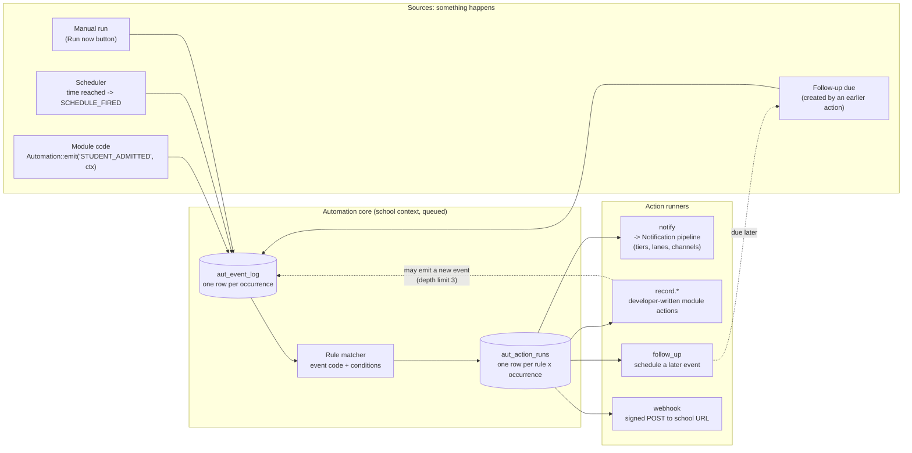
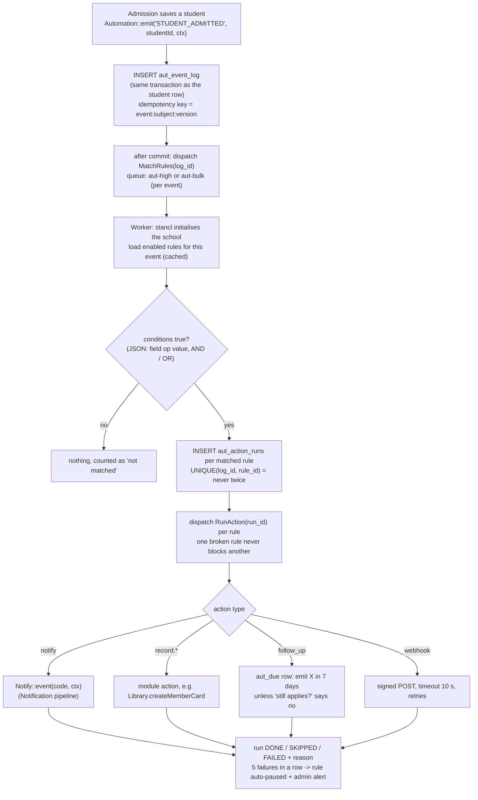
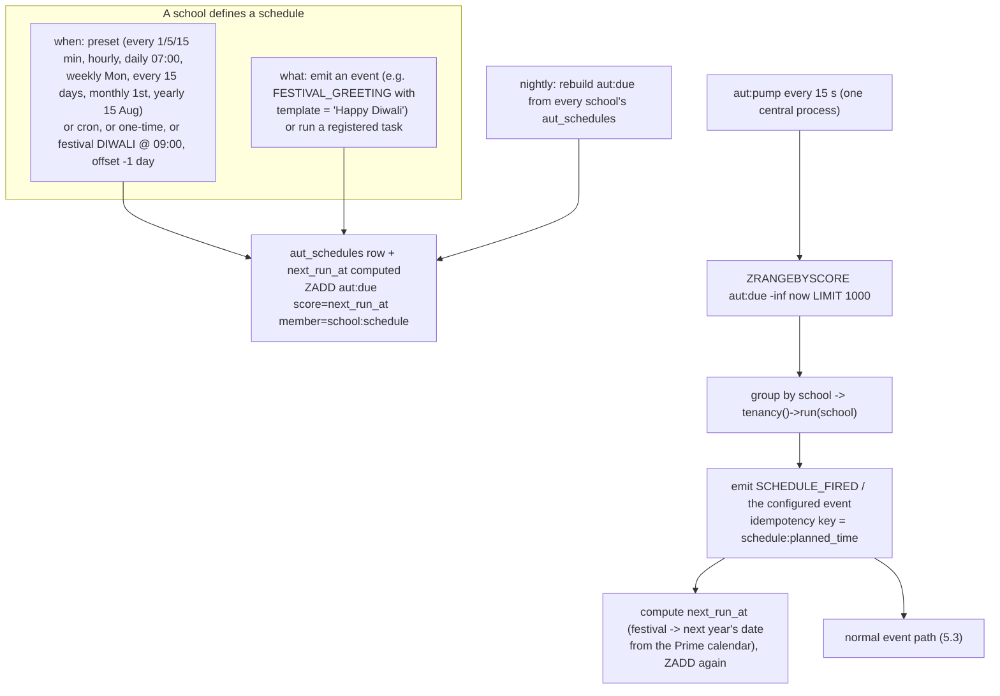
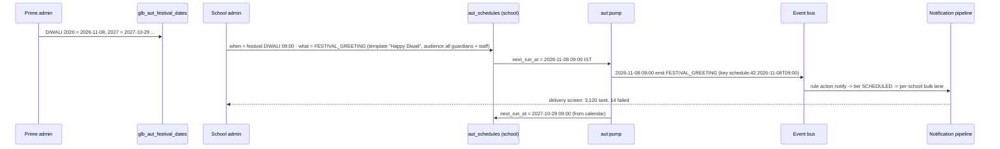
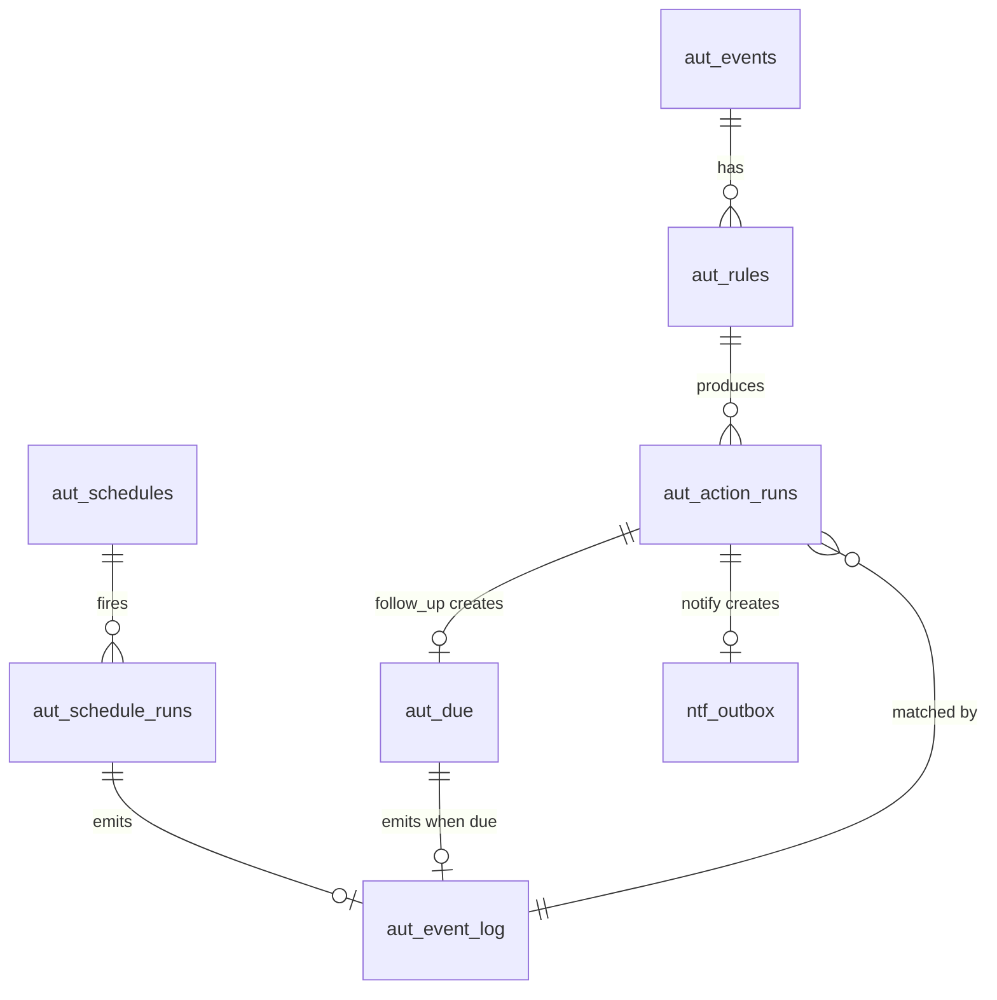

# Automation Core — Event Engine + Scheduler + Notification as One Shared Layer

**Owner:** Tarun Chauhan · **Written:** 9 October 2026 · **Status:** ANALYSIS + PLAN, nothing built
**Modules read:** `Modules/EventEngine`, `Modules/Scheduler`, `app/Console/Commands/RunSchedules.php`, plus every
module that already has its own events or schedules. **Read with:**
[../notifications-requirements/NOTIFICATION-QUEUE-ARCHITECTURE.md](../notifications-requirements/NOTIFICATION-QUEUE-ARCHITECTURE.md) (D9-D19) and
[../notifications-requirements/PHASE-0-STEPS.md](../notifications-requirements/PHASE-0-STEPS.md).

---

## 1. Short answer

1. **Yes, make it one core.** Event Engine, Scheduler and Notification are three faces of one mechanism:
   *something happens* (a record changes, or a time arrives) → *rules decide what follows* → *actions run on the queue,
   inside the right school*. Building them separately would mean building three registries, three rule tables,
   three queue/tenant set-ups, three run logs and three admin patterns.
2. **The core has four parts:** a **Registry** (events, actions, frequencies, festival calendar), an **Event Bus**
   (`Automation::emit()`), a **Scheduler** (time becomes an event), and **Action runners** (notify, record, follow-up,
   webhook). **Notification becomes the first and biggest action**; its delivery pipeline (tiers, lanes, channels)
   stays as already planned.
3. **What exists today is a skeleton:** Scheduler runs Prime jobs only and its tables were never migrated; EventEngine
   is switched off and its 3 tables do not exist. Meanwhile **7 other places** built their own small engines (§2.3).
   Nothing there needs saving, except the job-registry and cron ideas.
4. **Build order (your choice):** shared **Phase 0** (Redis / Horizon / queue isolation) → **core C1-C5** →
   **Notification** as an action → existing engines moved over one by one later.

---

## 2. What exists today (verified 9 Oct 2026)

### 2.1 Scheduler module

| Part | State |
|---|---|
| Tables `schedules`, `schedule_runs` (central) | migrations in the module, **never run**: no `schedules` table in `prime_db` |
| `SchedulableJob` contract + `JobRegistry` | a job declares `description()` and `allowedScheduleTypes()` (`prime` / `tenant`); 3 registered jobs, 2 of them test jobs |
| `SchedulerService::dueSchedules()` | loads **every** active schedule and tests its cron string in PHP (`CronExpression::isDue()`) |
| `scheduler:run-dynamic` (`app/Console/Commands/RunSchedules.php`) | dispatches due **Prime** jobs on the `database` connection; **tenant schedules "intentionally left as-is"** (`:100-102`); marks a run "success" when the job is **dispatched**, not when it finishes; **not in `routes/console.php`**, so it never runs |
| Screens | index / create / edit / trash; `update` and `destroy` excluded from the routes |

Worth keeping: the **registry of schedulable jobs** with a contract, and the **run log**. Everything else is rewritten.

### 2.2 EventEngine module

| Part | State |
|---|---|
| Status | **disabled** in `modules_statuses.json` |
| Models | `TriggerEvent` → `lms_trigger_event`, `ActionType` → `lms_action_type`, `RuleEngineConfig` → `lms_rule_engine_configs` |
| Tables | **none of the 3 exist** in any school DB, and the module has no migrations |
| Logic | CRUD controllers only. **Nothing emits an event or evaluates a rule.** Columns are LMS-specific (`applicable_class_group_id`). |

Worth keeping: the three-part idea (trigger → rule → action). The tables and models are replaced.

### 2.3 Engines other modules already built on their own

| Where | What | Kind |
|---|---|---|
| Accounting | `acc_module_events` (18 events: `FEE_DEMAND_RAISED`, `FEE_COLLECTED`, `LIB_FINE_COLLECTED` …) + `acc_event_processing_log` + `ProcessModuleEventsCommand` | event registry + processor (posts vouchers) |
| Recommendation | `rec_trigger_events` (5: `ON_ASSESSMENT_RESULT`, `ON_ATTENDANCE_DROP`, `ON_WEEKLY_REVIEW` …) + `rec_recommendation_rules` (169) | trigger + rules |
| BehaviouralAssessment | own outbox, dedupe, retry, `ba:sweep` (deadline / overdue / digest / exports) | events + schedules + notifications |
| 11 modules | **37 Laravel event classes, 25 listeners, 5 observers** (Payment 8, Hostel 7, BA 7, HrStaff 5, Inventory 4 …) | hard-coded "when X do Y" |
| `routes/console.php` | ~15 scheduled commands (homework / exam / syllabus release, BA sweeps, session rollover, backups, question statistics) | fixed schedules |
| Prime | `sys_backup_schedules`, `bil_tenant_email_schedules`, `tenant_plan_billing_schedules`, `SendScheduledEmail` job | schedules |
| Calendars | `sch_holidays` (6 rows) and `hrs_holiday_calendars` (84 rows) in the school DB: **free-text names, no festival code**, so "Diwali" cannot be matched reliably | dates |

**Decision (yours): new code uses the core now; these move over one by one later, each with its own go.**

---

## 3. Your decisions (9 Oct 2026)

| # | Decision |
|---|---|
| A1 | **Developers register** events and actions in code. **Prime** ships default rules. **Schools** add / edit rules by choosing event + condition + action from dropdowns. Nobody types code or SQL. |
| A2 | v1 actions: **send a notification**, **create / update a record** (only through developer-written actions), **schedule a follow-up**, **call an outside webhook**. |
| A3 | ~~Yearly festival schedules use a **Prime festival calendar** with each year's real date.~~ **Superseded 9 Oct (B5):** festivals come from the school's own `sch_holidays` rows via a new `holiday_code`; there is no Prime calendar. See [01-IMPLEMENTATION-PLAN.md](01-IMPLEMENTATION-PLAN.md). |
| A4 | Packaging: **one core "Automation" layer**; EventEngine and Scheduler become its admin screens. |
| A5 | Rules **always run on the queue, after commit**. Saving a record never waits for, or fails because of, a rule. |
| A6 | Schools may schedule as often as **every minute** (same as Prime). |
| A7 | Existing engines: **new code now, migrate one by one later.** |
| A8 | Order: **shared Phase 0 → core → Notification.** |

---

## 4. Why one core: the overlap

| Capability | Event Engine needs | Scheduler needs | Notification needs | Built once in the core as |
|---|---|---|---|---|
| Queue + right-school isolation | ✅ | ✅ | ✅ | Phase 0 (stancl `tenant_id`, pinned connections, Horizon) |
| Prime catalogue + school copy | events, actions | frequencies, schedulable tasks | notification events, templates | **Registry** (`glb_aut_*` → `aut_*`) |
| "When … then …" with conditions | ✅ | ✅ (time is the "when") | ✅ (which events notify whom) | **Rules** |
| Delay / reminder / cancel if no longer true | follow-ups | the whole point | `REM`, `SCHEDULED` tier | **Due index** + "still applies?" check |
| Dedupe / idempotency | an event must not fire a rule twice | a minute must not run twice | a parent must not get two messages | one **idempotency key** pattern |
| Run log + per-school visibility | rule runs | schedule runs | deliveries | `aut_event_log`, `aut_action_runs` + school screens |
| Retry, failure reason, auto-disable | ✅ | ✅ | ✅ | **Action runner** base class |
| Fairness between schools | busy school's rules | 200 schools × every-minute schedules | bulk sends | **lane cap per school** |

The notification plan already designed most of this (catalogue, outbox, dedupe, tiers, lanes, due index). The core
lifts those pieces one level up, so Event Engine and Scheduler get them for free.

---

## 5. The core

### 5.1 Overview



### 5.2 The four parts

| Part | Responsibility | Lives in |
|---|---|---|
| **Registry** | what events exist (code, module, payload fields), what actions exist (code, parameter form), frequencies, festival calendar, Prime default rules | Prime catalogue `glb_aut_*` (central), synced into each school as `aut_*` |
| **Event Bus** | `Automation::emit($code, $subjectId, $ctx)`: writes `aut_event_log` **in the caller's transaction**, dispatches `MatchRules` **after commit** | core service |
| **Scheduler** | turns time into events. A schedule = *when* (preset, cron, one-time, festival) + *what* (an event code with fixed context, or a direct task) | `aut_schedules` (school) + central schedules for Prime jobs |
| **Action runners** | one class per action type, implementing `AutomationAction`; idempotent; returns `DONE / SKIPPED / FAILED` + reason | each owning module (record actions), core (follow-up, webhook), Notification (notify) |

### 5.3 One event, start to finish



### 5.4 Time as an event (Scheduler)



Why a due index: with every-minute schedules allowed at 200 schools, "load every schedule of every school every
minute and test its cron" is 200 database switches a minute before any work starts. The index makes each 15-second
tick cost only **what is actually due**. The school DB stays the truth; the index is rebuilt nightly and on demand.

The planned time, not the actual run time, goes into the idempotency key (`schedule:42:2026-11-08T09:00`). So a slow
or repeated tick can never send the Diwali greeting twice.

### 5.5 The Diwali example



If Prime has not yet entered next year's date, the schedule shows **"waiting for 2027 date"** to the school, and Prime
gets a reminder in December. It is never silently skipped.

---

## 6. Data model

### 6.1 Central (Prime) — the catalogue

| Table | Purpose |
|---|---|
| `glb_aut_events` | every event a developer registered: `code`, `module`, `description`, `payload_schema_json` (fields usable in conditions and templates), `default_queue`, `is_schedulable` |
| `glb_aut_actions` | every action type: `code` (`notify`, `record.library.create_member_card`, `follow_up`, `webhook`), `module`, `params_schema_json` (drives the rule form), `is_school_usable` |
| `glb_aut_rules` | Prime default rules (event → conditions → action + params), copied into each school |
| `glb_aut_frequencies` | the presets Prime offers (every 1 / 5 / 15 min, hourly, daily, weekly, every N days, monthly, yearly, festival, one-time) |
| `glb_aut_festivals` + `glb_aut_festival_dates` | festival `code` (DIWALI, HOLI, EID_UL_FITR, …) and its date per year (optionally per region) |
| `schedules` / `schedule_runs` (existing Scheduler migrations) | **Prime-level** schedules (billing report, backups, tenant emails), kept central; renamed `prm_schedules` / `prm_schedule_runs` when migrated |

The registry tables are **filled from code** (`php artisan aut:sync-registry` reads every module's registered
events and actions). A developer adds an event by writing a class, never by editing the database.

### 6.2 School DB

| Table | Purpose |
|---|---|
| `aut_events` | school copy: `code`, `is_enabled` (a school can switch an event's rules off) |
| `aut_rules` | `event_code`, `conditions_json`, `action_code`, `params_json`, `origin` (PRIME / SCHOOL), `is_enabled`, `priority`, `consecutive_failures`, `paused_reason` |
| `aut_event_log` | one row per occurrence: `event_code`, `subject_type`, `subject_id`, `context_json` (ids only), `idempotency_key` UNIQUE, `chain_id`, `depth`, `status` |
| `aut_action_runs` | one row per (occurrence × rule): `UNIQUE(event_log_id, rule_id)`, `status`, `attempts`, `reason`, `result_json`, timings |
| `aut_schedules` | `name`, `when_type` (PRESET / CRON / ONCE / FESTIVAL), `when_json`, `what_type` (EVENT / TASK), `what_json`, `timezone`, `next_run_at`, `last_run_at`, `is_enabled` |
| `aut_schedule_runs` | `schedule_id`, `planned_at`, `started_at`, `finished_at`, `status`, `event_log_id` |
| `aut_due` | follow-ups and other one-off timed events: `due_at`, `event_code`, `context_json`, `still_applies_check`, `cancel_key`, `status` |
| `aut_webhooks` | school's webhook targets: `url`, `secret_encrypted`, `events`, `is_enabled`, failure counters |

Prefix **`aut_`** is unused today (checked against every prefix in the school and central DBs).
The notification tables (`ntf_outbox`, `ntf_recipients`, …) stay as planned. `ntf_outbox` simply gains an
`aut_action_run_id` when a send was started by a rule.



---

## 7. What a developer writes

```php
// 1. Declare an event (Admission module)
#[AutomationEvent(code: 'STUDENT_ADMITTED', module: 'Admission', queue: 'aut-high')]
final class StudentAdmitted implements DescribesPayload {
    public static function payload(): array {           // fields usable in conditions + templates
        return ['student_id' => 'id:std_students', 'class_id' => 'id:sch_classes',
                'section_id' => 'id:sch_sections', 'is_hosteller' => 'bool', 'admission_type' => 'enum:NEW,TRANSFER'];
    }
}

// 2. Fire it, inside the save transaction
Automation::emit('STUDENT_ADMITTED', $student->id, ['class_id' => $student->class_id, ...]);

// 3. Declare an action (Library module)
#[AutomationAction(code: 'record.library.create_member_card', module: 'Library')]
final class CreateMemberCard implements AutomationAction {
    public static function params(): array { return ['card_type' => 'enum:STUDENT,STAFF']; }   // rule form
    public function handle(ActionContext $ctx): ActionResult {   // idempotent: firstOrCreate on student_id
        ...
        return ActionResult::done(['card_id' => $card->id]);
    }
}
```

The rule form for a school is built from `payload()` and `params()`, so a new event or action appears in the
dropdowns after `aut:sync-registry` without any screen work.

---

## 8. Safety rules (these make school-built rules safe)

| Risk | Guard |
|---|---|
| A rule loop (action emits an event that triggers the same rule) | every occurrence carries `chain_id` + `depth`; **depth > 3 is refused** and logged |
| The same event fires a rule twice (retry, double click, re-run) | `UNIQUE(event_log_id, rule_id)` + action-level idempotency |
| A broken rule spams or blocks | each rule runs in its own job; **5 failures in a row auto-pause it** and alert the school admin |
| A school floods the workers (every-minute schedules × many rules) | **lane cap per school** (same funnel as notifications); a schedule may not fire faster than its own previous run finishes (`withoutOverlapping` per schedule) |
| "Create / update a record" corrupts data | only **developer-written** `record.*` actions exist; each validates its params and uses the module's own service |
| Webhook abuse (SSRF, leaking data) | HTTPS only, private / loopback IPs blocked, HMAC-SHA256 signature header, 10 s timeout, payload = event fields only (no PII beyond the payload schema), 3 retries then failed |
| Conditions as code injection | conditions are JSON (`field`, `op`, `value`, `AND` / `OR`) evaluated by the core. No `eval`, no SQL. |
| Wrong school | everything runs under stancl tenancy from the job's `tenant_id`; schedule pump runs `tenancy()->run($school)` per due item |
| Testing a new rule | **Dry run** button: evaluates the last 20 occurrences of the event and shows "would fire / would not", sends nothing |

---

## 9. How this changes the notification plan

| Notification plan item | With the core |
|---|---|
| `glb_ntf_events` catalogue | stays (channels, tier, templates, audience), but each notification event is **also** an `aut_events` code |
| `Notify::event()` | stays as the delivery entry point; called **by modules directly** for plain sends, **or** by the `notify` action from a rule |
| `SCHEDULED` tier + `REM` reminders (39 items) | built on the core's **due index** and **follow-up** action. Notification Phase 7 mostly moves into core C3/C4 |
| `THR` threshold alerts, `ESC` SLA ladders | become **scheduled rules** (a sweep event every N minutes + condition) instead of per-module crons |
| Plan Q-D (who owns the SLA watcher) | answered: the core |
| Lanes, tiers, channels, Reverb, push, per-school creds | unchanged |

Net effect: Notification gets **smaller**. 80 of the 400 requirement items (`REM` 39 + `THR` 15 + `ESC` 17 + `DIG` 9) are
delivered through core features rather than notification-specific code.

---

## 10. Build plan

| Step | What | Exit test |
|---|---|---|
| **Phase 0 (shared)** | the existing [PHASE-0-STEPS.md](../notifications-requirements/PHASE-0-STEPS.md), plus queues `aut-high`, `aut-bulk` in Horizon | isolation proof P1-P7 |
| **C1. Registry + bus** | attributes, `aut:sync-registry`, `glb_aut_events / actions`, school sync, `aut_event_log`, `Automation::emit`, `MatchRules`, `aut_action_runs` | an emitted event writes one log row in the caller's transaction and matches nothing yet; emitting twice with one key = one row |
| **C2. Rules + conditions + screens** | `aut_rules`, JSON conditions, rule form from schemas, dry run, auto-pause; **EventEngine module re-pointed** at these tables (old LMS models removed) | a school rule fires once per occurrence; a loop stops at depth 3 |
| **C3. Scheduler** | `aut_schedules`, presets / cron / one-time, due ZSET + pump, `aut_schedule_runs`; **Scheduler module re-pointed** (Prime jobs keep working centrally, now actually scheduled) | 200 simulated schools × every-minute schedule: tick < 1 s; no double run after a restart |
| **C4. Actions** | `follow_up` (+ "still applies?", cancel key), `webhook`, first `record.*` actions, festival calendar + `FESTIVAL` schedules | Diwali example end to end with a fake date; a cancelled follow-up never fires |
| **C5. Visibility** | school screens: event log, rule runs, schedule runs, failures; Prime: cross-school health | a school sees only its own rows |
| **Notification phases 1-6** | as planned; `notify` action wired in | — |
| **Migrations (one by one, each with a go)** | Accounting `acc_module_events` → events + a `record.accounting.post_voucher` action; Recommendation triggers; Laravel events/listeners; console schedules; BA last | per module |

---

## 11. Open questions (before the step that needs them)

| # | Question | Needed by |
|---|---|---|
| Q1 | Who maintains the festival calendar (Prime staff by hand each year, or an imported list)? Regional festivals (Pongal, Onam, Durga Puja) per state? | C4 |
| Q2 | Timezone: all schools IST, or a per-school timezone (international schools later)? | C3 |
| Q3 | Can a school **disable or edit** a Prime default rule, or only add its own next to it? | C2 |
| Q4 | Must a school-built rule be **approved** (e.g. by the principal) before it goes live, given it can message every parent? | C2 |
| Q5 | Retention of `aut_event_log` / `aut_action_runs` (they grow fastest): 90 days, then daily counts? | C5 |
| Q6 | The old EventEngine LMS-specific columns (`applicable_class_group_id`): drop entirely, or was there a planned LMS use that should become a condition field? | C2 |
| Q7 | Should the school holiday tables (`sch_holidays`, `hrs_holiday_calendars`) get an optional `festival_code`, so "on our school's Diwali holiday" uses the school's own date? | C4 |
