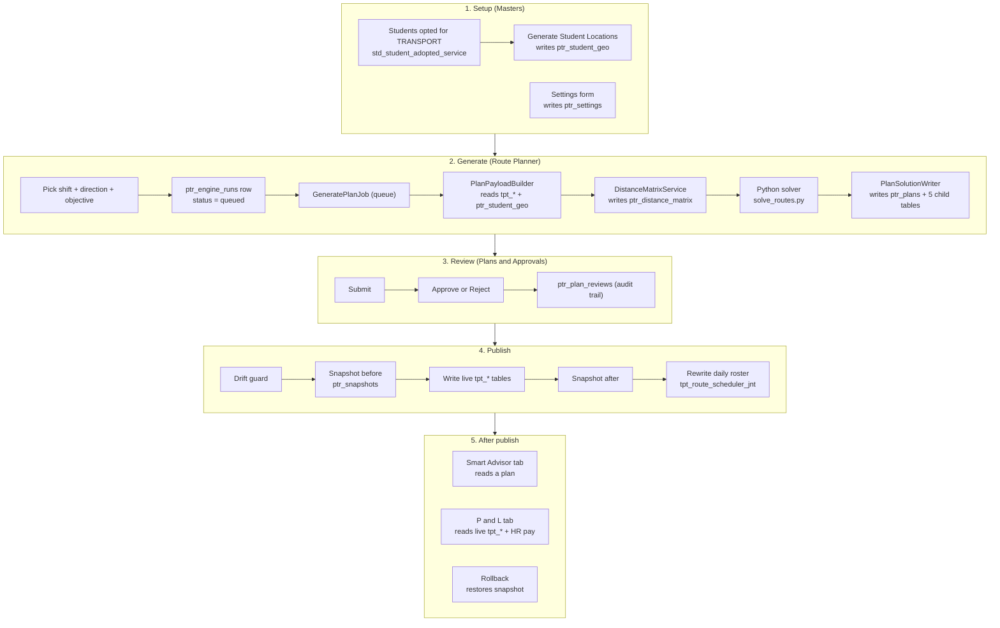
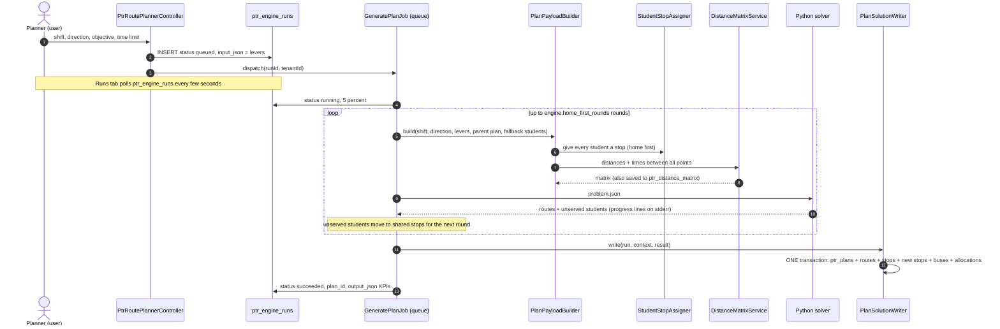
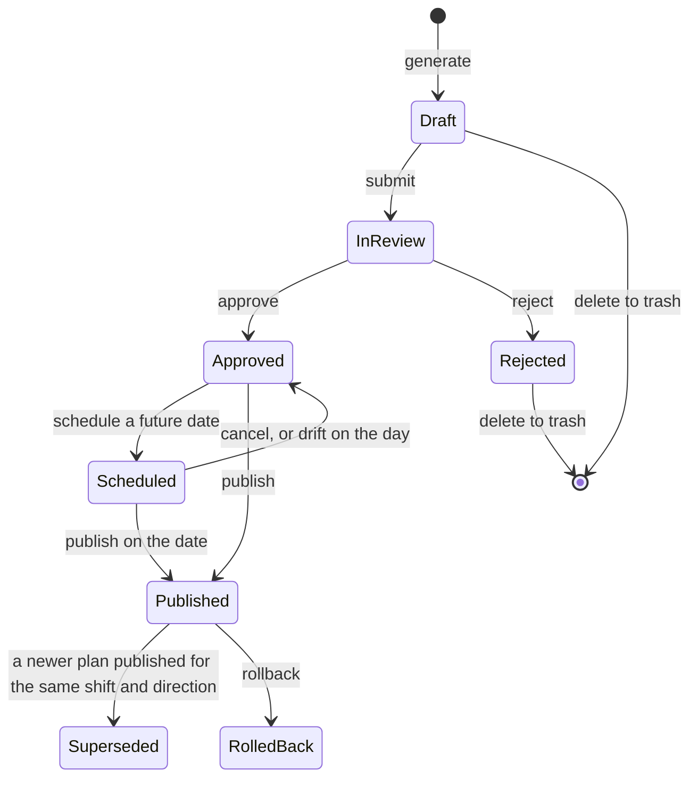
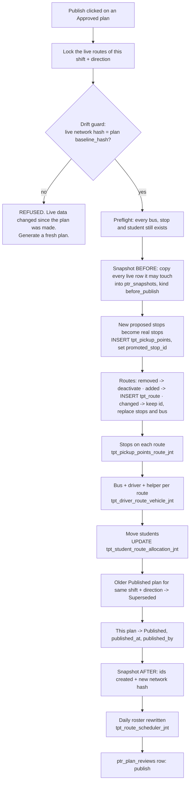

# PrimeTransport — how it works behind the scenes

**What this is:** the complete flow of the PrimeTransport module, from student homes to buses
running on the road — every step, what it reads, what it writes, and what changes when a plan is
published. Then a catalogue of every table it uses.

**Measured:** 2026-10-27, code on `development` (commit `563c53860`), data on `test.localhost`
(DB `xyz_school_00000000000040008000_202627`).

**Where the code lives:** `prime_ai/Modules/PrimeTransport/`

---

## 0. The idea in one paragraph

PrimeTransport **never edits the live transport network directly while it thinks.** It reads the
live Transport tables (`tpt_*`), works out a better set of routes in Python, and saves that answer
as a **Draft plan** in its own tables (`ptr_*`). A person reviews it, another person approves it,
and only **Publish** copies the plan into the live `tpt_*` tables — inside one database
transaction, after taking a snapshot of everything it will touch, so it can be **rolled back**.

```
   tpt_*  (live, what buses really run)  ──read──▶  PrimeTransport thinks  ──writes──▶  ptr_*  (plans)
     ▲                                                                                     │
     └──────────────────────────────── Publish (one transaction + snapshot) ◀─────────────┘
```

**Two kinds of table, never confuse them:**

| Prefix | Owner | Meaning |
|---|---|---|
| `tpt_*` | Transport module | **The real network today** — routes, stops, buses, who rides what, daily roster, trips |
| `ptr_*` | PrimeTransport | **Plans and thinking** — draft routes, students' proposed stops, approvals, snapshots, settings |

---

## 1. The whole module on one page



---

## 2. Step 1 — Setup

### 2.1 Student Locations — who needs a bus, and where they live

**Screen:** Prime Transport → Masters → Student Locations → **Generate**
**Code:** `StudentGeoGenerator`

| Reads | Why |
|---|---|
| `std_student_adopted_service` + `std_student_services` (code `TRANSPORT`) | only students who **opted for transport** in the current session |
| `std_student_addresses` | the row flagged `is_pickup_location` (pickup lat/lng) and `is_drop_location` (drop lat/lng) |

| Writes | What |
|---|---|
| `ptr_student_geo` | one row per student: home lat/lng, drop lat/lng, address, source, consent |

⚠ **Every Generate empties `ptr_student_geo` first and rebuilds it.** A student without a usable
pickup address is skipped and listed as "missing" — no point is invented.

**Today:** 1,383 rows.

### 2.2 Settings — the rules the planner follows

**Screen:** Masters → Settings. **Code:** `PtrSettingsRegistry` (the list of keys and defaults),
`PtrSettingsService` (read/save). **Table:** `ptr_settings` (36 rows).

Groups: Route Engine (ride-time limits per age band, pickup mode per band, near-stop distance,
home-merge distance, walk distance, speed, cost per km, junior shift codes…), Smart Advisor,
Live Operations, Maps & Distances (haversine or OSRM), **Profit & Loss** (rent, insurance,
depreciation estimates).

A key with no row uses its default from the registry.

---

## 3. Step 2 — Generate a plan

**Screen:** Route Planner → Generate tab. **Route:** `POST route-planner/generate`.

### 3.1 What happens, step by step



### 3.2 What the builder reads (nothing is written to `tpt_*`)

| Table | Used for |
|---|---|
| `tpt_shift` | the shift being planned, and which shifts are junior |
| `ptr_student_geo` | every student to plan, with their home point |
| `std_student_academic_sessions`, `sch_class_section_jnt`, `sch_classes` | the student's class (age band → ride-time limit) and their own transport shift |
| `tpt_pickup_points` | existing stops a student may walk to |
| `tpt_vehicle` | the fleet: active, available buses and their seats |
| `tpt_route`, `tpt_pickup_points_route_jnt`, `tpt_driver_route_vehicle_jnt` | **today's network** — to compare against, and to fingerprint (see drift guard) |
| `tpt_student_route_allocation_jnt` | who rides what today (live KPIs, and so publish can move them) |
| `ptr_plan_locks` | things pinned on the parent plan (a stop stays on its bus, etc.) |
| `sch_organizations` | the school's location |
| `sch_org_academic_sessions_jnt` | the current session |

### 3.3 How each student gets a stop — `StudentStopAssigner`

Home first (decided 2026-10-26):

1. **Near stop** — an existing stop within `engine.near_stop_m` → use it.
2. **Home** — otherwise picked up at home; homes within `engine.home_merge_m` of each other share one doorstep pickup.
3. **Shared** — for students whose age band is set to shared pickup, or who did not fit in an earlier round: nearest existing stop within the walk distance, else a new proposed stop at the centre of neighbours, else still home.

A proposed stop has a **negative id** (-1, -2, …) while it is only an idea. Codes: `HP-nnn` home pickup, `NS-nnn` shared stop.

### 3.4 Distances — `DistanceMatrixService`

`maps.distance_source` = `haversine` (straight line × road factor, always available, an
**estimate**) or `osrm` (real road distance from a self-hosted OSRM server; a missing pair falls
back to the estimate). Every pair is upserted into **`ptr_distance_matrix`** (43,472 rows today) —
a cache, safe to clear.

### 3.5 The solver — Python

`python/solve_routes.py` → `prime_transport/vrp.py` (Google OR-Tools vehicle routing).
**PHP owns the database, Python owns the algorithm.** PHP writes a JSON problem file into the
tenant's storage and passes its path; Python has no database connection, no credentials, no tenant.
It prints one JSON answer on stdout and `@progress {...}` lines on stderr, which become the progress
bar. The problem file is kept per run, so "what did the engine receive?" can always be answered.

**Rounds:** after each solve, students the solver could not fit (ride-time limit, seats) are moved
to the shared-stop rule and the problem is solved again, up to `engine.home_first_rounds`.
The last round is the plan.

### 3.6 What the writer saves — `PlanSolutionWriter` (one transaction)

| Table | Rows written | What |
|---|---|---|
| `ptr_plans` | 1 | the plan: code `PLN-YYYYMMDD-HHMMSS-<run>`, shift, status **Draft**, `levers_json` (what was asked), `kpi_json` (plan vs live: buses, km, ride times, cost/day, unserved), **`baseline_hash`** (fingerprint of the live network it was computed from) |
| `ptr_plan_routes` | 1 per route | code, name, direction, km, minutes, students, geometry, **`change_kind`** vs live: added / changed / unchanged / removed (`source_route_id` = the live route it replaces) |
| `ptr_plan_route_stops` | 1 per stop on a route | sequence, pickup/drop time, km from school; `stop_id` (existing stop) **or** `new_stop_id` (proposed) |
| `ptr_plan_new_stops` | 1 per proposed stop | lat/lng, code, name, reason; `promoted_stop_id` is filled only at publish |
| `ptr_plan_vehicle_assignments` | 1 per route | bus, driver, helper, seats used |
| `ptr_plan_allocations` | 1 per student | the student's pickup or drop route + stop in the plan, walk metres, ride minutes, `change_kind`, and `source_allocation_id` (their live allocation row, so publish can move them) |

Then `ptr_engine_runs` is updated: `status = succeeded`, `plan_id`, `output_json` (KPIs, route
count, unserved count, seconds taken).

**If anything fails**, the run row gets `status = failed` and a user-safe `error_text`; nothing
half-written survives (one transaction). **Cancel** sets `status = cancelled`; the job checks for it
between solver progress events.

### 3.7 What-if Lab — the same pipeline with levers

**Screen:** What-if Lab. A what-if run is a normal generate with extra levers in `levers_json.whatif`
(bus change, walk zone, stop changes…). It produces a plan that **never appears in Plans & Approvals**
(`PtrPlan::notWhatIf()` filters on `levers_json->whatif`). Up to 3 can be compared side by side.
**Promote** turns one into an ordinary Draft plan.

### 3.8 Locks

**Screen:** a plan's page → lock a stop, bus, route or driver. **Table:** `ptr_plan_locks`
(`plan_id`, `lock_type`, `target_id`). The NEXT run based on that plan (`parent_plan_id`) keeps those
pins.

---

## 4. Step 3 — Review and approve

**Screen:** Plans & Approvals. **Code:** `PlanReviewService`.



| Rule | Enforced by |
|---|---|
| Only Draft or Rejected plans can be deleted (soft delete → trash) | `PtrPlan::DELETABLE_STATUSES` |
| Whoever made or submitted a plan may not approve it (Super Admin may) | `PlanReviewService` |
| The whole plan is approved or rejected — never part of it | `PlanReviewService` |
| Two people clicking Approve at once cannot both win | row lock on the plan |

**Every step appends one row to `ptr_plan_reviews`** — step (submit, approve, reject, comment,
schedule, publish, rollback), decision, comment, who, when. It is the plan's **audit trail and is
never edited.** A comment can point at one route (`plan_route_id`).

---

## 5. Step 4 — PUBLISH (the important part)

**Screen:** Plans & Approvals → Publish. **Code:** `PlanPublishService::publish()` and
`PlanRosterService::sync()`. Everything below runs in **ONE database transaction** — it all happens
or none of it does.

### 5.1 The sequence



### 5.2 What each step does to which table

| # | Step | Table | What changes |
|---|---|---|---|
| 1 | **Drift guard** | (reads) `tpt_route`, `tpt_pickup_points_route_jnt`, `tpt_driver_route_vehicle_jnt`, `tpt_student_route_allocation_jnt` | rebuilds the fingerprint of today's network for this shift + direction and compares it with `ptr_plans.baseline_hash`. Any edit since the plan was made (a route, a stop, a bus, a student's allocation) **refuses** the publish |
| 2 | **Snapshot before** | `ptr_snapshots` (`kind = before_publish`) | full copies of every `tpt_route`, `tpt_pickup_points_route_jnt`, `tpt_driver_route_vehicle_jnt` row of this shift + direction, and every allocation row the plan moves. **This is the rollback source** |
| 3 | **Promote new stops** | `tpt_pickup_points` INSERT · `ptr_plan_new_stops.promoted_stop_id` UPDATE | each proposed stop a kept route uses becomes a real stop (location `POINT` SRID 4326, `stop_type` Both, the shift, the transport plan). Code/name made unique with a `-P<id>` suffix if taken |
| 4 | **Removed routes** | `tpt_route.is_active = 0`, its `tpt_pickup_points_route_jnt` rows `is_active = 0`, its `tpt_driver_route_vehicle_jnt` rows ended | **never deleted** — trips, boarding logs and the roster still point at them |
| 5 | **Added routes** | `tpt_route` INSERT | with `tpt_plan_id` = the active `tpt_transport_plan` of the shift covering today. A code already taken gets a `-P<planId>` suffix (e.g. `PLN-R01-P5`) |
| 6 | **Changed routes** | `tpt_route` kept (same id and code) | its stops and bus are replaced |
| 7 | **Stops on routes** | `tpt_pickup_points_route_jnt` insert/update; stops no longer used `is_active = 0` | sequence, times, and **each stop keeps the fare it already had** |
| 8 | **Buses** | `tpt_driver_route_vehicle_jnt` INSERT | bus, driver, helper, shift, direction, from today, `is_active = 1` |
| 9 | **Students** | `tpt_student_route_allocation_jnt` UPDATE | the moved student's `pickup_route_id`/`pickup_stop_id` (or drop) for this direction. **A student the plan could not seat keeps the stop but loses the route**, so the next plan sees them as needing a seat. **Fares are NOT changed** |
| 10 | **Supersede** | `ptr_plans.status` | the previously Published plan of the **same shift + direction** → Superseded. Plans of other shifts are untouched — so four plans (one per shift/direction) are Published at the same time |
| 11 | **Mark published** | `ptr_plans` | status Published, `published_at`, `published_by` |
| 12 | **Snapshot after** | `ptr_snapshots` (`kind = after_publish`) | ids of every row the publish CREATED, and the new network hash (used by rollback's own drift check) |
| 13 | **Daily roster** | `tpt_route_scheduler_jnt` | see §5.3 |
| 14 | **Audit** | `ptr_plan_reviews` + `sys_activity_logs` | who published, when |

### 5.3 The daily roster — `PlanRosterService`

Transport keeps two records of who drives what:

| Table | Grain | Written by |
|---|---|---|
| `tpt_driver_route_vehicle_jnt` | **one row per route** — "Route 5: Bus 3, Driver 2, from 1 Nov" | publish step 8 |
| `tpt_route_scheduler_jnt` | **one row per route per DAY** — what trips and attendance are made from | this roster step |

For the plan's shift + direction, from the effective date to the **end of the academic session**:

1. Only routes the plan **touched** change (removed, added, changed, or bus changed). An untouched
   route keeps its roster, including hand-made one-day overrides.
2. A date on which a touched route **already has a trip** (`tpt_trip`) is left alone — that day
   started on the old routes.
3. Every other date: the old rows are deleted (copied into a `manual` snapshot with
   `scope_json.purpose = roster` first) and new rows written from the active assignments.
4. A row that would put a bus, driver or helper on two routes the same day is **skipped and
   counted**, never forced.

**Measured:** each senior plan wrote ~4,650 roster rows over 155 days; each junior plan ~1,404 over 156 days.

### 5.4 What a publish does NOT touch

- Student **fares** (`tpt_student_route_allocation_jnt.fare`) — unchanged.
- Routes of **other shifts/directions** — unchanged.
- Trips already made (`tpt_trip`), boarding logs (`tpt_student_boarding_log`) — never edited.
- Buses themselves (`tpt_vehicle`) and staff (`tpt_personnel`) — read only.

### 5.5 Rollback

**Code:** `PlanPublishService::rollback()`, one transaction:

1. **Drift check** against the after-publish hash — if someone edited the live network since the
   publish, rollback refuses (it would overwrite their work).
2. Undo the **roster** runs, newest first (restore deleted rows; delete created ones that have no trip).
3. **Restore** every row from the before-publish snapshot.
4. **Remove** rows the publish created: assignments and route-stop rows deleted; created routes
   deleted, or soft-deleted if a trip/roster/boarding/allocation already points at them; created
   stops trashed (`is_active = 0`, `deleted_at`) and `promoted_stop_id` cleared.
5. The plan it superseded goes back to **Published**; this plan becomes **RolledBack**.

### 5.6 Scheduled publish

**Schedule** sets status `Scheduled` and `effective_from`. The command
`php artisan tenant:prime-transport:publish-scheduled` (hourly, needs the `schedule:run` cron)
publishes it on the date **as the person who scheduled it**. If the drift guard refuses on the day,
the plan returns to **Approved** with the reason in `ptr_plan_reviews`.

### 5.7 Why "one live plan per shift + direction"

A plan covers exactly one `shift_id` + one direction (Pickup or Drop). The test school has 4 shifts
× their direction = **4 plans live at once**:

| Shift | Direction | Live plan (2026-10-27) |
|---|---|---|
| 1 Senior Morning | Pickup | plan 5 |
| 2 Senior Afternoon | Drop | plan 6 |
| 3 Junior Morning | Pickup | plan 7 |
| 4 Junior Afternoon | Drop | plan 4 |

Since commit `1a66c212e` (2026-10-27) each student's own `transport_shift_id` decides whether they
are junior or senior (`ShiftTiming::isJuniorStudent()`; class rule only when the shift is not set), so
a plan counts **only its own group's students** and publishing one group's plan does not change the
other group's fingerprint.

---

## 6. Step 5 — After publish

### 6.1 Smart Advisor tab

**Code:** `PlanAdvisorService::analyse()` — reads one plan (`ptr_plans` + `ptr_plan_routes` +
`ptr_plan_vehicle_assignments` + `ptr_plan_allocations`), `tpt_vehicle` (cost per km), fares.
Finds: fewer buses, double-shift bus reuse, stop merges, under-used buses, fares below cost, high
cost per student. Shows rupee ranges.

**Save suggestions** writes `ptr_advisor_runs` (one per save) and `ptr_suggestions` (one per idea,
de-duplicated by `dedupe_key`). Accept / dismiss / snooze writes `ptr_suggestion_outcomes`.
**Apply** (fleet ideas) queues a what-if run with the lever, linked by `parent_plan_id`.

### 6.2 P&L tab

**Code:** `TransportPnlService::forMonth()` — **read only.** Works on the **live** network, not a plan:

| Number | Table(s) |
|---|---|
| Income | `tpt_student_route_allocation_jnt.fare` (half to each leg's bus) + `tpt_student_fine_detail` via `tpt_student_fee_detail` |
| Bus ↔ route ↔ crew | **active** `tpt_driver_route_vehicle_jnt` + `tpt_route` |
| Fuel, km/L, fuel-log km | `tpt_vehicle_fuel` |
| Maintenance | `tpt_vehicle_maintenance` → `tpt_vehicle_service_request` → `tpt_daily_vehicle_inspection` |
| Crew pay (CTC ÷ 12) | `tpt_personnel` → `sch_employees` → `hrs_salary_assignments` |
| Estimates | `ptr_settings` (`pnl.*`) |
| Plan km | Published `ptr_plans` → `ptr_plan_routes` → `ptr_plan_vehicle_assignments` |
| Operating days | `tpt_route_scheduler_jnt` |
| Trust panel | `tpt_trip` (odometer check) |

---

## 7. Every table — what it stores and how it is used

Row counts measured 2026-10-27 on test.localhost.

### 7.1 PrimeTransport's own tables (`ptr_*`)

#### Core planning

| Table | Rows | Stores | Written by | Read by |
|---|---:|---|---|---|
| `ptr_engine_runs` | 7 | one row per Generate / What-if run: `run_type` (full_plan, what_if, …), `status` (queued → running → succeeded / failed / cancelled), `progress_pct`, `stage`, `input_json` (levers), `output_json` (KPIs), `error_text`, `plan_id` | Generate button (insert), `GeneratePlanJob` (updates) | Runs tab (polled live) |
| `ptr_plans` | 7 | the plan header: `code`, `name`, `shift_id`, `academic_session_id`, `status` (8 values, §4), `source`, `parent_plan_id`, `effective_from`, **`baseline_hash`**, `levers_json` (what was asked; `whatif` key marks a scenario), `kpi_json` (plan vs live), submitted/approved/published/rolled-back stamps | `PlanSolutionWriter`, review and publish services | everything |
| `ptr_plan_routes` | 194 | the plan's routes: `code`, `name`, `pickup_drop`, `shift_id`, `total_distance_km`, `est_duration_min`, `student_count`, `route_geometry`, `change_kind` vs live, `source_route_id`, `change_note` | writer | plan page, publish, advisor, P&L (plan km) |
| `ptr_plan_route_stops` | 2,013 | each stop on each planned route: `sequence`, `pickup_time`/`drop_time`, `distance_from_school_km`, `stop_id` **or** `new_stop_id`, `change_kind` | writer | plan route page, map, publish |
| `ptr_plan_new_stops` | 1,493 | stops the plan invented (home pickups `HP-`, shared `NS-`): lat/lng, `code`, `name`, `reason`, **`promoted_stop_id`** (the real `tpt_pickup_points.id` once published) | writer (insert), publish (promoted id), rollback (clears it) | publish, map |
| `ptr_plan_vehicle_assignments` | 148 | per planned route: `vehicle_id`, `driver_id`, `helper_id`, `seats_used`, `effective_from`, `change_kind` | writer | publish, roster, advisor, P&L |
| `ptr_plan_allocations` | 5,346 | per student per plan: pickup/drop planned route + stop, `walk_distance_m`, `ride_minutes`, `change_kind`, **`source_allocation_id`** (their live row) | writer | publish (moves students), impact, advisor, unserved list |
| `ptr_plan_locks` | 0 | pins on a plan: `lock_type` (stop / vehicle / route / driver / student), `target_id`, `reason` | plan page | `PlanPayloadBuilder` for the NEXT run from that plan |

#### Review, publish, rollback

| Table | Rows | Stores | Written by | Read by |
|---|---:|---|---|---|
| `ptr_plan_reviews` | 14 | append-only audit trail: `step`, `decision`, `comment`, `reviewer_id`, `decided_at`, optional `plan_route_id` | review, publish, schedule, rollback | plan page history |
| `ptr_snapshots` | 13 | `kind` (before_publish / after_publish / manual), `scope_json` (shift, direction, purpose), `payload_json` (the copied rows or created ids + hash), `checksum`, `row_count` | publish, roster | rollback, impact |

#### Inputs, caches and settings

| Table | Rows | Stores | Written by | Read by |
|---|---:|---|---|---|
| `ptr_student_geo` | 1,383 | each transport student's home (`latitude`, `longitude`), drop point, address, `geocode_source`, consent | Student Locations Generate (truncate + rebuild), the CRUD tab | `PlanPayloadBuilder`, writer (walk distance) |
| `ptr_distance_matrix` | 43,472 | cached point-to-point `distance_m` and `duration_s`, with `source` (osrm / haversine / manual) | `DistanceMatrixService` | the next run (cache); Masters → Distance Cache (read-only) |
| `ptr_settings` | 36 | one row per changed setting: `group`, `key`, `value_json` | Masters → Settings | every service via `PtrSettingsService` |
| `ptr_rule_settings` | 18 | advisor rule switches: `rule_code`, `family`, `is_enabled`, `severity`, `params_json` | Masters → Rule Settings | advisor |
| `ptr_safety_rules` | 15 | safety thresholds: `code`, `threshold_json`, `severity`, `score_penalty` | Masters → Safety Rules | (future) safety scoring |
| `ptr_segment_speeds` | 0 | learned speeds between two stops per time band | (future) from GPS logs | (future) planner |

#### Smart Advisor

| Table | Rows | Stores | Written by | Read by |
|---|---:|---|---|---|
| `ptr_advisor_runs` | 0 | one per "Save suggestions": trigger, status, scope, count | `PlanAdvisorService::persist()` | Smart Advisor tab ("last saved") |
| `ptr_suggestions` | 0 | one per idea: `rule_code`, `severity`, target, `title`, `detail_json`, `impact_json` (₹ range), `dedupe_key`, `status`, `snoozed_until` | `persist()` | Smart Advisor tab |
| `ptr_suggestion_outcomes` | 0 | each decision: accepted / dismissed / snoozed, reason, the what-if `plan_id` if applied | decide / apply | Smart Advisor tab, savings ledger |

#### Built for later — tables exist, nothing writes them yet

| Table | Intended for |
|---|---|
| `ptr_admission_quotes` | quoting a stop, route and fare for an admission enquiry's address |
| `ptr_disruptions` | breakdowns, absent drivers, road closures, with a temporary roster override |
| `ptr_eta_live` | live arrival estimates per trip and stop |
| `ptr_safety_scores` | driver safety scores per day/week/month |

### 7.2 Transport tables PrimeTransport reads — and which ones Publish writes

| Table | Rows | Stores | PrimeTransport… |
|---|---:|---|---|
| `tpt_shift` | 4 | the shifts (code, name, timing) | reads |
| `tpt_transport_plan` | 4 | Transport's own plan per shift (validity dates) | reads; publish puts its id on new routes and stops |
| `tpt_vehicle` | 35 | buses: capacity, ownership, availability, cost per km | reads |
| `tpt_personnel` | 74 | drivers and helpers | reads |
| `tpt_pickup_points` | 707 | stops: code, name, `location` POINT | reads; **publish INSERTs** new stops; rollback trashes them |
| `tpt_route` | 125 (78 active) | routes: code, name, direction, shift, geometry | reads; **publish inserts / updates / deactivates** |
| `tpt_pickup_points_route_jnt` | 1,183 | which stops a route visits, in what order, times, fare | reads; **publish writes** |
| `tpt_driver_route_vehicle_jnt` | 148 (78 active) | which bus, driver, helper run a route, from when | reads; **publish writes**; P&L uses the active rows |
| `tpt_student_route_allocation_jnt` | 1,383 | each student's pickup/drop route and stop, and **monthly fare** | reads; **publish UPDATEs** routes/stops (never fare); P&L reads fare |
| `tpt_route_scheduler_jnt` | 12,132 | the daily roster, one row per route per day | **roster step deletes and writes**; P&L counts days |
| `tpt_trip` | 360 | trips actually run (odometer, fuel) | read: a day with a trip is never re-rostered; P&L trust check |
| `tpt_student_boarding_log` | 4,119 | who boarded where | read: protects a route from hard delete on rollback |
| `tpt_vehicle_fuel` | 140 | fuel fills: litres, cost, odometer | P&L reads |
| `tpt_vehicle_maintenance` | 36 | maintenance jobs and cost | P&L reads |
| `tpt_vehicle_service_request`, `tpt_daily_vehicle_inspection` | 36 / 49 | the link from a job to its bus | P&L reads |
| `tpt_student_fee_detail`, `tpt_student_fine_detail` | 300 / 50 | transport bills and fines | P&L reads fines |

### 7.3 Other modules' tables it reads

| Table | Module | Used for |
|---|---|---|
| `std_student_adopted_service`, `std_student_services` | Student | who opted for transport |
| `std_student_addresses` | Student | home / drop coordinates |
| `std_student_academic_sessions` | Student | class section and own transport shift |
| `sch_classes`, `sch_class_section_jnt` | SchoolSetup | age band (ride-time limit), junior/senior |
| `sch_organizations` | SchoolSetup | school location |
| `sch_org_academic_sessions_jnt` | SchoolSetup | current session, its end date (roster horizon) |
| `sch_employees`, `hrs_salary_assignments` | SchoolSetup / HrStaff | crew pay for P&L |
| `sys_dropdown_table` | SystemConfig | bus ownership label |
| `sys_activity_logs` | core | every publish, rollback, approval and saved setting is logged |

---

## 8. Data journey of ONE student

*Illustration — the name, codes and times are made up; the tables and columns are real.*
Riya (Class 6, senior, home 300 m from any stop) rides the morning pickup.

| When | Table | What is stored |
|---|---|---|
| Opts for transport | `std_student_adopted_service` | TRANSPORT, Active |
| Locations generated | `ptr_student_geo` | her home lat/lng |
| Plan generated | `ptr_plan_new_stops` | `HP-042` at her door (no stop within 100 m, home first) |
| | `ptr_plan_route_stops` | `HP-042` is stop 7 on `PLN-R03`, pickup 07:21 |
| | `ptr_plan_allocations` | Riya → `PLN-R03`, stop `HP-042`, walk 0 m, ride 24 min, `changed` |
| Published | `tpt_pickup_points` | new stop row (`HP-042`), `promoted_stop_id` set |
| | `tpt_pickup_points_route_jnt` | stop on route `PLN-R03-P5`, seq 7, 07:21 |
| | `tpt_student_route_allocation_jnt` | her `pickup_route_id`, `pickup_stop_id` updated; **fare unchanged** |
| | `tpt_route_scheduler_jnt` | route's bus/driver per day until session end |
| Each school day | `tpt_trip`, `tpt_student_boarding_log` | the trip, her boarding |
| P&L | — | half her monthly fare counts on her pickup bus, half on her drop bus |

---

## 9. Safety nets, in one place

| Net | Protects against |
|---|---|
| Plans live in `ptr_*` until publish | half-finished thinking reaching the buses |
| Drift guard (`baseline_hash`) | publishing a plan computed from data that has since changed |
| One transaction per publish | a half-applied network |
| Before/after snapshots | an irreversible publish |
| Removed routes are deactivated, not deleted | breaking trips, boarding logs and roster history |
| Days with trips are never re-rostered | orphaned trips |
| No self-approval | one person changing every route alone |
| Append-only `ptr_plan_reviews` | a missing audit trail |
| Python has no DB access | the solver corrupting data |

---

## 10. Known gaps (2026-10-27)

- `ptr_admission_quotes`, `ptr_disruptions`, `ptr_eta_live`, `ptr_safety_scores`, `ptr_segment_speeds` are built but unused.
- Trip odometers are zero on all trips, so real distance comes only from fuel fills.
- Crew pay comes from demo salaries (`PayrollSalaryRegisterDemoSeeder`).
- After a code change, **restart the queue worker** or runs use old code.
- The P&L estimate settings (`pnl.*`) are 0 until set.
